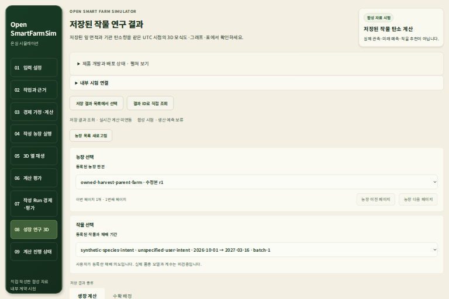
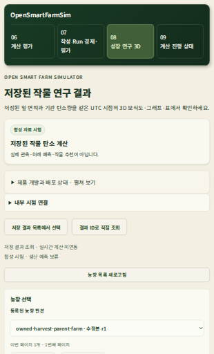

# 저장 결과 목록의 개발 기록 접근 — 2026-10-20

## 범위와 관측

U1의 농장/작물/저장 결과 선택을 먼저 사용할 수 있도록 긴 개발 기록을 접는 동작 자식이다.
기존 결과·계수·수치 계산·API/DB·현재 권리와 승인 디자인의 스타일은 변경하지 않는다.
현재 native Codex CLI `gpt-6.1-sol` / `xhigh` 세션에서 판단했으며 CLI를 재귀 실행하지 않았다.

변경 전 현재 minified 빌드의 desktop-loaded/desktop-empty/mobile-loaded를 실제 Chromium으로
캡처했다. 긴 개발 기록이 첫 화면을 차지해 농장·작물 선택이 아래로 밀렸다.
이 캡처는 기존 공개 시험 metadata를 `Fetch.fulfillRequest`로 전달한 UI 시험이다.
자체 프록시는 실제 `/v1/` API를 403으로 차단했다. 실제 농장 자료·수치 결과·3D 검증이 아니다.

## 원 승인 디자인 대조의 별도 보류

원본은 [기존 디자인 준비 기록](product-ui-result-selector-design-preparation-20261009.md)의
desktop-loaded/desktop-empty/mobile-loaded PNG/HTML이다. 다른 이미지를 승인 원본으로 대체하지 않았다.
기존 원 conversion ID 3개는 올바른 power recovery에서도 서비스의 `conversion not found`로
LayerDoc를 확보하지 못했다. 원 PNG/HTML은 보존돼 있다.

실제 설치된 12ui 0.2.65의 `improve --target`을 사용했다. 처음 세 로컬 캡처 시도는 합산 RSS
한도로 종료됐으며 캡처/변환 수용에 넣지 않는다. 네 번째는 같은 1536×1024 viewport와 full-page를
유지하고, 자체 정적 HTTP 서버를 도구 Node 프로세스 안에서 실행해 Python 대기자만 없앴다.
설치된 CLI·브라우저 본체·대상 이미지·현재 DOM/내용은 수정하지 않았다.

네 번째 캡처는 정착됐으나 변환 서비스가 `Too many conversions are already in progress`로
요청을 거부했다. 기록된 같은 idempotency key의 `--from convert` 재개 2회도 같은 오류였다.
최초 요청과 두 재개 모두 실제 종료 1·자원 종료 사유 없음이며 kit의 변환/plan은 미완료다.
`--fresh`/`--redraw`나 대체 변환은 실행하지 않았다. 구매가 정착됐다는 기록과 conversion ID는 없다.
외부 서비스 한도가 해소되면 이 kit의 같은 key로 이어간다. 완료된 디자인 대조로 보고하지 않는다.

이 문서의 기능 수정은 관측된 정보 접근 문제에 대한 네이티브 disclosure이며,
미완료 kit의 이미지에서 CSS·텍스트·레이아웃을 손으로 복제하는 작업은 하지 않았다.

## 구현과 수용 기준

source `265c63ae933be284317a903e1d6278f3ffe18e8c`:

- 목록 경로에서만 개발 기록을 기본으로 접는다. 같은 위치의 summary로 전체 기존 기록과
  계산 진행 화면 버튼을 키보드로 펼친다.
- 직접 ID 조회와 다른 화면은 기존 펼친 기록을 유지한다. 합성 시험·미래 예측/추천 보류 안내와
  접속 설정은 기록 밖에도 남는다. 수치·목록·credential을 저장하거나 새 계산을 접수하지 않는다.
- 1536×1024 / 620×1024에서 문서 맨 위의 농장 선택 제목, Enter/Space로 기록 열기/닫기,
  선택·10개 행·요청 수 보존과 직접 조회 복귀를 검사한다.

로컬 타입 검사는 실제 종료 0, 4.480551초, 합산 최대 RSS 844,668,928bytes로 통과했다.
보호 5root·두 UI·원본 2,148개·FD 4→4·소유 프로세스/PG/임시 파일 정리를 확인했다.
전체 웹 CI [39420818193](https://github.com/KIMSUNGHOON/OpenSmartFarmSim/actions/runs/39420818193)는
35파일/단위 1,864개·Chromium 250개(새 2조건 포함)·타입·프로덕션 빌드·보안 high 기준을 통과했다.
backend 전체 CI와 native Solar job은 실행하지 않았다. 통과한 빌드의 ZIP/자산/146 source 핀을 대사했다.

같은 빌드의 WSL native 검사는 실제 종료 0, 10.711449초, 단일/합산 최대 RSS
323,469,312 / 907,010,048bytes로 통과했다. 0.25초 간격 41표본·고정 한도·보호 5root·두 UI·원본 2,148개·
FD 4→4·소유 nginx/브라우저/프로세스·임시 PG/passfile 잔여 0을 확인했다.
세 상태에서 글꼴 로드와 가로 넘침 없음을 확인했고, 두 화면 크기에서 실제 Enter/Space 입력으로
열기/닫기·선택/10행/추가 목록 요청 0을 대사했다. 수치 결과·실제 API/DB·WebGL을 사용하지 않았다.

문서 scrollY=0에서 농장 선택 제목은 desktop y=525.84–548.23px,
mobile y=852.66–875.05px로 실제 viewport 안에 있다. desktop-loaded/desktop-empty의
첫 viewport PNG는 동일하다. 결과 표/빈 상태는 아래에 있으므로 첫 화면의 두 결과 상태 구분이나
원 세 디자인의 전체 대조를 수용하지 않는다. 이번 수용은 개발 기록 접근 동작 자식에 한정한다.

[기계 증거](artifacts/catalog-development-disclosure-20261020.json)에 실제 캡처·키보드·원 hash·guard와
디자인 보류를 함께 기록했다. 아래 이미지는 DPR 0.5의 공개 시험 metadata 화면이다.

두 사용자 주소의 개발 진행 JSON은 검증 기록으로 갱신했다. 실제 5173/5174의 200·동일 bytes·
`Cache-Control: no-store`, 두 frozen HTML과 환기 source 2,173파일 보존을 확인했다.
새 UI 코드 적용이나 두 주소의 DOM 재검증은 하지 않았다. 이 게시 guard는 실제 종료 0,
0.351569초·합산 최대 RSS 521,998,336bytes와 소유 정리로 통과했다.

## 남은 범위

현재 source의 검색 범위도 대사했다. 서버 `KINDS`, SDK `CropCatalogKind`,
`SelectedCropReplay`는 calculation-cycle/harvest 두 kind만 허용한다.
다음 세 기존 판본은 직접 ID 조회가 구현돼 있으나 현재 목록 선택에는 없다.

| 판본 | 기존 저장 표 | 현재 연결 |
| --- | --- | --- |
| 기관 `crop-result-v1` | `crop_research_results` | `CropResultStore.get` / 직접 조회 |
| 기관·50구획 `crop-result-v2` | `crop_coupled_research_results` | `CoupledCropResultStore.get` / 직접 조회 |
| startup `crop-result-v3` | `crop_startup_research_results` | `StartupCropResultStore.get` / 직접 조회 |

각 표의 `recorded_at`과 현재 권리/HMAC 재검사 경로는 source에서 확인했다.
이번에는 실제 DB의 행 존재·최신 reader 호환성을 시험하지 않았다.
따라서 다음 구현은 첫 기관 판본의 보호 metadata→닫힌 SDK→기존 재생 전달을 한 묶음으로
검증한 뒤 구획/startup으로 확장한다. 원 payload를 목록 응답에 노출하거나 기존 결과를 재계산·재서명하지 않는다.
실제 원 ID/농장/UTC·권리 철회·늦은 응답·페이지 경계와 WSL 자원 검증이 각 묶음의 완료 조건이다.

원 세 디자인 대조, 기관/구획/startup의 기존 결과 검색·선택 범위, 최신 backend의 구판 CODE 지원,
API/브라우저 동시 재시작·권리의 RSS hold, 실제 사용자 적용과 전체 U1은 미완료다.
새 목록 UI/버튼·Solar는 미배포이며 실제 농장 Run 0·G0–G4 보류·전체 완료일 미정을 유지한다.
UI fixture의 통과를 실제 품종·생산량·수확·경제·추천 검증으로 사용하지 않는다.
