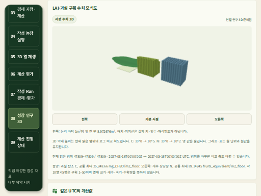
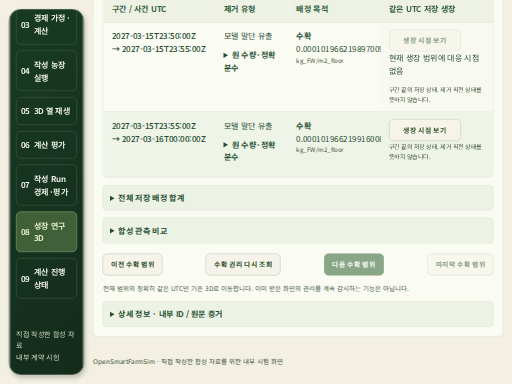

# 마지막 저장 생장 시점·수확 범위의 실제 UI 수용 — 2026-10-20

[기계 증거](artifacts/catalog-full-period-final-range-20261020.json) ·
[작은 화면 계약](../contracts/web-crop-harvest-final-range-v1.md).

## 구현과 전체 웹 검증

기존 생장 화면에는 마지막 시점 이동이 있지만 수확 화면에는 이전/다음 이동만 있었다.
원 빌드에서 실제 저장 수확3행을 읽은 뒤 버튼 부재를 RED로 확인했다.
현재 수확 범위 탐색에 **마지막 수확 범위** 버튼을 추가했다. 기존3행 페이지의 끝으로
한 번의 기존 조회를 보내며, 현재 권리/부모 결속·취소·원 수량/단위 처리는 바꾸지 않았다.
키보드 직접 이동·끝 경계/이전 복귀와 끝 조회의 권리 거부 회귀2개를 추가했다.

source `a3103a90a0397dc7454ce808c4f4742b371c84be`의
[CI39413382844](https://github.com/KIMSUNGHOON/OpenSmartFarmSim/actions/runs/39413382844)는
**35파일/단위1,864개·브라우저248개·타입·프로덕션 빌드·보안 high 기준**을 통과했다.
backend 전체 CI와 독립 Solar job은 이 수용에 포함되지 않는다.
같은 실행의 minified artifact12260469641·184파일/146source핀을 대사했다.
ZIP SHA256은 `24b6dbbcecdb191565c1f1b4b057afa5aaf541c1ffa8287c7b095689b29ab532`다.

판단은 현재 native Codex CLI `gpt-6.1-sol / xhigh`에서 했다. 실제 문맥 시각·원행/실행기
해시는 기계 증거에 기록했다. 재귀 CLI와 하위 에이전트는 실행하지 않았다.

## 원 저장 reader의 실제 HTTPS·WebGL

새 API/DB를 만들지 않고 원 code-pinned reader에서 같은 농장/작기·원 생장/수확 ID를 선택했다.
실제 GET **13응답 모두200**, 원 바이트/길이·단위·UTC를 관측했으며 mock을 사용하지 않았다.

| 확인 | 실제 원 범위 |
| --- | --- |
| 최초 저장 생장 | index0 · `2026-10-01T00:00:00Z` |
| 마지막 저장 생장 | index47,808 / 전체47,809 · `2027-03-16T00:00:00Z` |
| 마지막 수확 페이지 | offset47,811 · 원2행 / 전체47,813 · 다음 없음 |
| 마지막 수확의 생장 연결 | row47,812의 같은 UTC만 원 마지막 생장 시점으로 선택 |

첫/마지막 생장과 마지막 수확에서 선택한 부모의3장면 각각에서100개 C/N 값·단위/표,
LAI 허용 오차와 실제 WebGL2/양수 draw-call을 확인했다.
끝 수확2행의 원 질량/단위·UTC를 대사했다. 현재 단일 생장 시점과 UTC가 다른 앞 행의
연결은 비활성화되고, 같은 UTC인 마지막 행은 실제 버튼으로 원 부모를 선택했다.
마지막/다음 수확 버튼은 끝에서 비활성화됐다. 중간 수확 페이지를 순회하지 않았다.

끝 HTTP 원 본문을 private으로 보존하고 마지막 행을 원 형식의 canonical JSON+LF로 대사했다.
원 저장 manifest의 row47,812 해시와 실제 행 해시가 모두
`acddfc00e4441ae79327a9c8f0805825428792f73235db6d68fefc5d1ac0ac03`이었다.
원 기록·입력·서명을 다시 만들지 않았다.

두 실제 캡처를 직접 확인했다. DPR0.5의 원 검증 조건이다. 그림은 LAI/구획 수치 모식도이며
실제 품종의 높이·과실 모양·생산 예측을 검증한 이미지가 아니다.

guard는 **종료0/90.145702초·단일354,701,312/합1,057,628,160bytes**였다.
원512MiB/PID·합1GiB/600초/.25초·원 Chromium/pipe/viewport를 유지했다.
page/console error0·FD4→4·시험 소유 프로세스/PG/passfile/임시 잔여0,
원본2148개와 보호5root/하위 서비스·기존 두 frozen HTML/자산을 보존했다.

## 앞선 실행기의 키 입력 실패

첫 새 빌드 실행은 마지막 생장 시점까지 읽었으나 수확 이동 요청이 없었고 offset 대기로 종료했다.
수확 버튼은 존재하고 활성 상태였다. 이 실행은114.463733초·종료1/원본·한도/정리로 보존했다.

소유한 빈 버튼 fixture에서 기존 CDP Enter는 신뢰된 keydown/keyup만 만들고 클릭0이었다.
Enter 문자 정보를 포함하자 신뢰된 keypress/click이 추가되고 클릭1이 됐다.
고정 Playwright1.63.0의 Chromium 입력 구현과
[CDP의 text/unmodifiedText 정의](https://github.com/ChromeDevTools/devtools-protocol/blob/master/pdl/domains/Input.pdl)를
대조하고 해당 실행기의 Enter 전달만 고쳤다. JavaScript로 클릭하지 않았고 제품 코드/CI 빌드,
원 데이터·시간/RSS 조건은 유지했다. 수정한 입력으로 위 실제 전체 경로를 다시 수용했다.

## 남은 범위

이번 수용은 저장 기간의 첫/끝 대표 시점과 끝 수확 페이지 탐색이다. 브라우저에서47,809시점·
47,813행 모두를 검증하거나 실제 한 작기의 농업적 정확도를 입증한 것은 아니다.
새 목록 UI와 이 버튼은 사용자 포트에 미배포다.
기존 desktop-loaded/desktop-empty/mobile-loaded 원 디자인 대조, 기관/구획/startup 검색 범위,
최신 backend의 구판 CODE 지원·동시 API 재시작/권리 브라우저의 RSS hold와 전체 U1은 남는다.
U2–U5·새 Solar/전체 작기·자원/경제·실제 CLI 종단 간 G1과 독립 농장/시장·G0–G4도 미완료다.
실제 농장 Run0·전체 완료일 미정을 유지한다.

개발 기록을 `2026-10-20T11:36:19.808451Z`로 갱신했다. 두 사용자 주소의 같은 JSON200/
`no-store`, 원 HTML과 환기 frozen2173파일 보존을 확인했다. 이 게시 검사는 HTTP 범위이며
사용자 포트의 새 UI 배포나 새 DOM 수용은 아니다.
