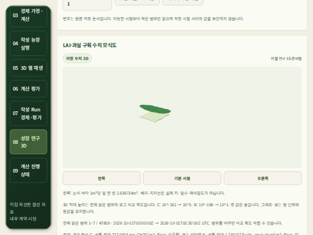

# 현재 제품 빌드의 저장 목록→3D·수확 연결 — 2026-10-20

[기계 증거](artifacts/catalog-stored-replay-current-browser-20261020.json) ·
[이전 메모리/탐색 관측](catalog-navigation-memory-evidence-20261020.md).

## 수용 범위

**현재 frontend와 지원하는 저장 판본 reader 사이의 실제 목록→생장/수확 재생 경로를 수용했다.**
실제 SCRAM DB/검증된 HTTPS API를 읽은 시험이며 응답 mock을 사용하지 않았다.
합성166일 저장 결과의 소프트웨어 연결 증거다. 최신 backend의 구판 CODE 지원,
API 재시작·권리 철회 등 U1 전체와 실제 농장 생산/경제 검증은 계속 미수용이다.
새 목록 UI와 새 Solar를 사용자 포트에 배포하지 않았다.

## 화면 결함과 전체 웹 CI

고정 sidebar 탐색 결함 뒤 전체 CI는320px/32px에서 문서 폭329px로 실패했다.
진단은 스크롤 컨테이너 안의 정상적인 표/메뉴를 제외한 **공통 개발 상태 목록의 긴 문구**를
원인으로 좁혔다. 상태 영역에 `overflow-wrap:anywhere`를 적용하고 긴 단어의 확대 글자
회귀를 추가했다. 문서 폭의 수용 조건은 원래의 `scrollWidth <= innerWidth`를 유지했다.
일시적인 DOM 진단 코드는 제거하고 실패 메시지에 화면 폭/글자 크기만 남겼다.

[CI39402294371](https://github.com/KIMSUNGHOON/OpenSmartFarmSim/actions/runs/39402294371)의
정확한 source는 `8ad6c24f6b3f13fbea15c0fd75f1511b593a304a`다.
**35개 파일/단위1,864개·브라우저246개, 타입·프로덕션 빌드·보안 high 기준**을 통과했다.
브라우저246에는 새 탐색2개·상태 줄바꿈1개가 포함된다. 앞선 실패3실행은 보존했다.
새 backend 전체 CI, 독립 Solar normal64와 native Solar 검증 job은 이 수용에 포함되지 않는다.

같은 실행의 minified 프로덕션 artifact12255897635를 받아 ZIP SHA256
`402dba10906108885121669c028e2ca64352bb3673702d75345194fd9544b941`을 대사했다.
경로/중복/symlink·압축 해제 크기,184파일·source146핀을 확인했다.
빌드 취득 guard는 종료0/7.634829초·합551,641,088bytes였다.

## 실제 저장 재생 6장면

이 빌드와 기존 code-pinned reader에서 farm→crop→저장 결과를 선택했다.
생장47,809시점/수확47,813행의 원 ID와 부모를 사용했다. 다음6장면에서 각각
원 C/N100값·단위/표·UTC와 LAI 허용 오차·WebGL2/양수 draw-call을 대사했다.

1. 최초 저장 생장 시점.
2. 바로 다음 저장 시점.
3. 수확 결과를 선택했을 때 같은 생장 부모.
4. 390×844의 모바일 부모 재생.
5. 새로고침·계정 연결 뒤 같은 결과 재선택.
6. 잘못된 계정의401/이전 화면 제거 뒤 정상 계정으로 복구한 같은 결과.

원 수확3행의 시각·생과중/단위를 확인했다. API는 **GET24응답: 200×23,401×1**이었다.
200의 원 바이트를 직접 관측해 길이/2MiB 한도·JSON·SHA를 확인했다.
401은 SDK가 본문을 읽기 전에 거부하므로 헤더의 실제 상태만 채택했다.
해당 원 actor의 cache 문자열은 설정값이며 독립적인401 헤더 검증으로 사용하지 않는다.

이전 v9–v11은 각각 재연결 화면 제거, native focus,401 관측 타이밍에서 실패했다.
DOM 크기만으로 접힌 details의 입력 가시성을 판단한 실행기 오류를 수정했다.
details의 실제 open 상태·native focus·required 유효성·재연결 초기화를 확인하고,
401을 responseReceived에서 기록했다. 제품 권한 처리나 원 수치/응답은 변경하지 않았다.
실패 결과를 보존했으며 전체 경로의 최종 수용은 v12 종료/정리 뒤에만 판단했다.

최종 guard는 **종료0/118.112716초·단일375,050,240/합1,025,470,464bytes**다.
원512MiB/PID·합1GiB·600초/.25초,1024×768/390×844·DPR0.5를 유지했다.
FD4→4·시험 소유 프로세스/PG/passfile/임시 잔여0, 원본2148개·두 frozen UI와5root를
확인했다. 앞선 실행과 보호 서비스의 할당이 다르므로 두 합계로 성능 개선율을 주장하지 않는다.

[모바일 실제 캡처](artifacts/catalog-stored-harvest-mobile-20261020.png)도 직접 확인했다.
이미지는 LAI/과실 구획 **수치 모식도**다. 실제 줄기 높이·과실 모양·품종 생육의 시각 검증이나
미래 생산량 예측으로 사용하지 않는다.

## 다음 한 단계

`product-ui-result-catalog-native`/U1은 계속 열려 있다. 다음은 기존 계약에 따라
실제 API 재시작과 현재 권리 철회/복원·늦은 응답의 생장/수확 제거를 검증할 준비다.
저장 판본 reader와 최신 backend의 구판 CODE 지원을 구분하고, 원 manifest/서명을
바꾸지 않는다. 기존3상태 디자인·다른 저장 모델/전체 기간·U1 사용자 적용도 남는다.

백엔드 app261의 SHA는591eff7d…로 그대로이며 같은 source의 Solar normal64를 반복하지 않았다.
원 정상→독립 hold→HTTP취소→계산 중 WebGL→WSL 적용과 U2–U5/실제 CLI 종단 간 G1,
독립 자료/농장·경제/시장 및 G0–G4는 별도다. 실제 농장 Run0·전체 날짜 미정·goal active다.
native CLI gpt-6.1-sol/xhigh 문맥·출력 SHA를 보존했고 재귀 CLI/하위 agent는0이다.

기존5173/5174에는 새 진행 기록만 게시해 두 HTTP200/no-store·같은 bytes와 원 HTML/환기 source2173개를 대사했다. 빌드 뒤 갱신한 feed는 별도 정적 자산이며 검증된 dist와 제품 코드는 수정하지 않았다.
