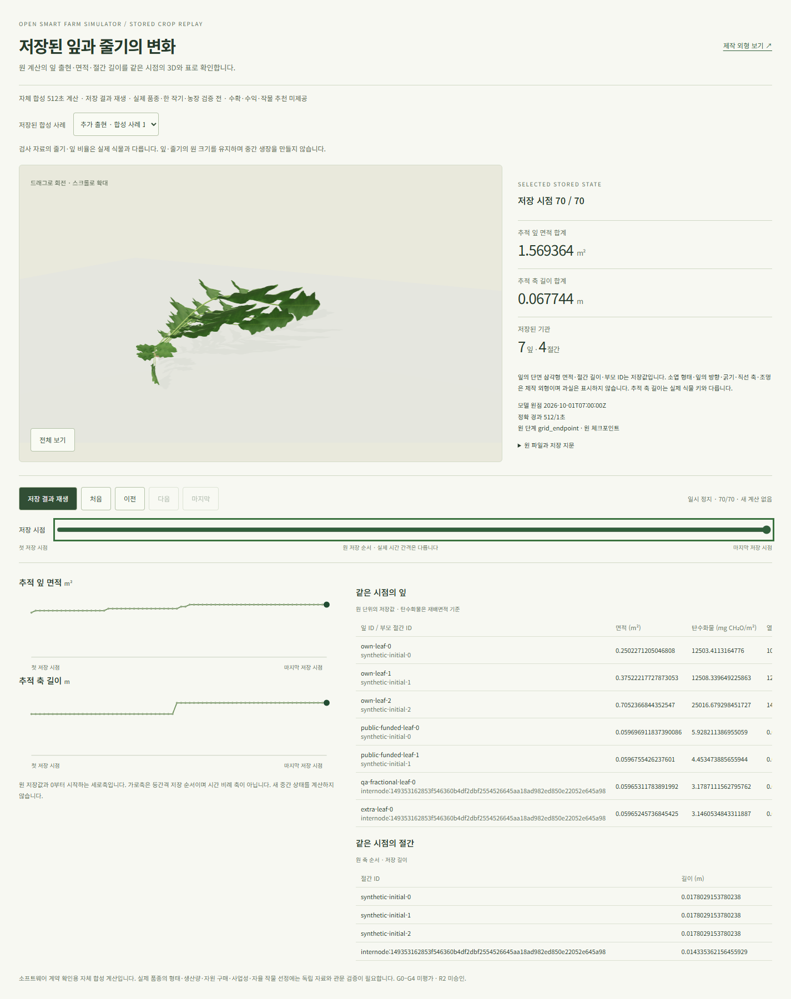

# 같은 저장 상태의 잎·줄기 3D — 2026-10-27 KST

자체 합성 전체 이력 SDK를 별도 사용자 화면에 연결했다. [미리보기](http://localhost:5180/complete-crop-replay.html)에서 사례 선택 → 원 파일 검사 → 저장 시점 재생·이전/다음 → 같은 시점의 3D·표·그래프를 확인한다. 기존 [제작 외형](http://localhost:5175/crop-appearance.html)과 동결된 이전 재생 파일은 보존했다.

**수용 범위는 합성 연구 결과의 기능 연결이다.** 실제 품종·한 작기·생산/수확·자원 구매·경제/거시·수급·자율 작물 비교·제품 farm/worker 통합과 최종 사실감은 완료되지 않았다. G0–G4는 `not_assessed`, R2는 `not_approved`다. 독립 국내 농장 측정은 0건이며 새 외부 자료를 채택하지 않았다.

## 사용자가 확인할 변화

기존 [strict SDK](complete-crop-strict-sdk-20261027.md)가 검증한 12개 자료를 그대로 사용한다. 일반 6개는 각각 69시점·3→6잎, 추가 출현 6개는 각각 70시점·3→7잎이다. 절간은 3→4개다. 합계 834시점, 잎 기록 4,596건의 면적/탄수화물/열적 나이 13,788값, 절간 길이 2,956값과 CP 없는 원 후보 12건을 재생한다.

잎 삼각형의 단면 면적과 각 절간 길이는 원 단위의 저장값이다. 잎은 같은 상태의 실제 부모 ID에 붙인다. 원점·정확 분수 초·phase와 체크포인트 없는 후보를 유지한다. 원 탄수화물·열적 나이는 표에 표시한다. 그래프의 가로축은 명시한 저장 순서이며 시간 비례 축이 아니다. 재생은 원 frame 선택이고 중간 생장을 계산하지 않는다.

잎맥/소엽 재질은 승인된 자체 제작 자산을 재사용했다. 소엽 형태·방향·굵기·직선 축·조명·카메라는 제작 외형이다. 초기 QA 입력은 잎 면적 0.25/0.375/0.705m²와 짧은 절간을 함께 지정해 실제 식물 비율과 맞지 않는다. 이 비율을 숨기려고 수치를 바꾸지 않았다. 계산 장면의 과실은 숨긴다. 기존 제작 외형은 화면 메뉴에서 따로 볼 수 있다.

[모바일 실제 캡처](artifacts/complete-crop-stored-replay-mobile-20261027.png). 위 캡처를 직접 검사했으며 생물학적 형태·최종 사실감 승인으로 처리하지 않는다.

## 통과한 검증

| 항목 | 실제 결과 |
| --- | --- |
| 집중 단위 | 110개 통과: 기존 SDK/상태 68 + 새 geometry 13 + URL 29 |
| 독립 형상 측정 | 12자료의 시작·끝·기관/잎 출현 경계에서 world 삼각형 cross product 면적과 줄기 경계 대사; 상대 면적 차이 <5e-12 |
| 최신 전체 웹 타입 | 통과. TypeScript 7 네이티브 컴파일러에 `GOMEMLIMIT=256MiB`, `GOGC=50`, `GOMAXPROCS=2` 적용 |
| 새 전용 설정 타입 | 기존 strict 설정을 상속한 집중 검사 통과 |
| 별도 실제 빌드 | 새 재생+기존 외형 2개 entry 통과; 총 4,865파일/71,119,601bytes, 원 공개 자료 4,732파일 포함 |
| 실제 Chrome | 새 소유 headless Chrome 16시험 통과, 834시점 전체의 실제 mesh 면적/부모·줄기 길이/ID·원 UTC/phase·표/그래프 대사 |
| 사용자 흐름 | 메뉴 복귀/reload의 같은 artifact/frame, 재생/정지·유휴 렌더 정지, 빠른 사례 교체, 회전/확대/전체 보기, 390×844 모바일 및 가로 넘침 없음 |
| 실패 경로 | 원 index 변조 때 3D/표/그래프 제거·재검사 복구, WebGL2 실패 때 검증된 원 표 유지 |
| 실제 사용자 주소 | 5180의 CSP/해시 고정 서버에서 추가 출현 사례의 마지막 7잎/4절간·원 면적/길이/시간·reload/모바일 확인, console error 0 |

새 화면은 `CompleteCropReplayPage` → `CompleteCropScene` → `createCompleteCropPlant`로 기존 SDK를 소비한다. 계산 모듈이나 CLI를 UI에서 실행하지 않는다. [계약](../contracts/complete-crop-stored-replay-v1.md), [구조화 증거와 지문](artifacts/complete-crop-stored-replay-20261027.json)을 참고한다.

## 실행·자료·자원 증거

판단은 현재 native Codex CLI의 실제 `gpt-6.1-sol` / `xhigh` turn context에서 수행했다. 관측 시각은 2026-10-26T15:50:34Z, context 시각은 15:41:56.177Z이며 원 LF SHA-256은 `7960d2255d1c9428a6148885bb25f7a7be0c7040facc837a63db49509897c944`다. 재귀 CLI 실행은 0회다.

원 공개 자료 4,732파일의 bytes/hash·68개 기존 SDK 의존 지문과 이전 private:false 132blob·이전 화면 1,502파일의 bytes/metadata·원 최대 요청 hold를 별도 대사했다. 신규 미리보기는 자체 공개 합성 자료와 빌드 파일만 제공하고 API·DB·키·개인 농장 자료를 사용하지 않는다. 12시간의 새 소유 수명을 등록했으며 **2026-10-27 13:09:40 KST 만료**다. 만료된 이전 5177 서비스의 수명/권한을 연장하지 않았다.

각 집중 검증은 WSL 프로세스당 512MiB/소유+보호 1GiB, 0.25초 표본·600초·4MiB 로그 제한에서 순차 실행했다. 최신 빌드 단계의 관측 최대 PID RSS는 525,217,792bytes, 합계는 607,350,784bytes다. 마지막 브라우저 16시험은 129.83초이며 WSL 최대 PID/합계는 30,023,680/93,896,704bytes다. Windows Chrome/Node의 Windows 메모리와 호스트 전체 메모리는 이 Linux 수치로 측정하지 않았다. 검증 소유 프로세스는 정리됐으며 선언한 미리보기와 기존 외형 서비스만 유지한다.

최초 타입 시도 2회는 WSL RSS 한도로 중단했다. Node heap 설정이 네이티브 TypeScript 프로세스의 RSS를 제한하지 않는 것을 로컬 실제 실행 파일에서 확인하고 Go 제한을 적용했다. 집중 설정 첫 시도의 `vite/client` type 경로 오류도 수정했다. 최초 빌드/15시험 뒤 기본 카메라의 빈 공간을 실제 캡처에서 확인해 최초/명시 reset 구도만 조정했고 최신 빌드와 전체 시험을 다시 통과했다. 자료 검사 실패 전후에도 새 선택을 URL에 남기도록 보완한 뒤 새 1시험을 포함한 16시험 전체를 다시 통과했다. 이전 시도는 보존한다.

`12ui-design`은 기존 승인 레이아웃/자산을 적용하고 명시 target의 dry-run을 확인했다. 새 유료 변환/디자인 생성은 실행하지 않았다. 기존 승인 캡처와 실제 데스크톱/모바일을 직접 비교했으며 자동 12ui 유료 정렬 완료를 주장하지 않는다.

## 남은 보류와 다음 단계

- 새 Chrome 세션의 최초 cold 셰이더 컴파일 warning X4122가 1건씩 남았다. 브라우저 기능 검사와 실제 보이는 창·최종 시각 품질 R2는 구분한다. 이전 headful 숨김 관측을 통과로 바꾸지 않았다.
- 기존 전체 주앱 빌드는 이번 2-entry 빌드로 대체 수용하지 않는다. 제품의 현재 farm 권리·새 결과/worker 연결도 별도다.
- 기존 512잎 전체 요청은 직렬화 byte cap hold다. 이번 3–7잎 장면으로 최대 요청/최대 렌더링 수용을 주장하지 않는다.
- 새 절간별 탄소 배분/성장 제한과 초기 잎의 출현 이력·기관 비율 정합성은 아직 모델에 결속되지 않았다. 새 줄기를 0비용으로 간주하거나 QA 외형을 실제 생물학으로 승격하지 않는다.

다음 한 단계는 기존 aggregate 줄기 탄소와 기관별 배분·신장 제한, 초기 기관 이력의 **모델 수용 조건을 조사·정의하는 작은 작업**이다. 근거/단위/수지·초기 상태/변경 시점·0/부족/충분 탄소 반례와 독립 검산 기준을 먼저 고정하고, 수용한 규칙 하나를 결정적 계산으로 구현한다. 실제 품종·농장 자료 확보는 병행한다. 이 조사/계약 작업은 잠정 1–2.5집중시간이며 후속 계산 구현 공수는 그 결과로 산정한다. 전체 완료 날짜는 실제 자료 확보와 한 작기/자원·경제/거시/수급·후보 비교 작업 분해 전에는 정할 수 없다.
