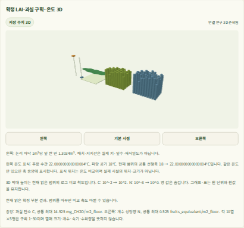
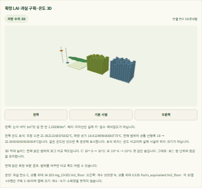

# 계산 중 연속 수치3D의 사용자 연결 — 2026-10-11

**21:19 KST에 A2를 수용했다.** 같은 사용자 DB의 실제 자동 계산 중 서로 다른 원 UTC **5개**가
표·그래프·WebGL에 전진했고, 완료 원9시점/관리3사건과 재접속을 확인했다.
[A1의 128초 입력 재현](crop-climate-joint-prefix-advance-input-20261011.md)과
[관측 계약](../contracts/crop-climate-joint-prefix-advance-observation-v1.md)의 후속이다.
[기계 증거](artifacts/crop-climate-joint-prefix-advance-browser-reference-20261011.json)의 SHA-256은
`8c36bd96087a078117cb41d051a4ebbaa26c8fda7da2f5d362eaaf4715a84524`다.

현재 **http://localhost:5174/** 는 계산 상태/확정 부분 결과를 자동 조회한다.
**http://localhost:5173/** 은 완료된166일 저장 결과 재생을 유지한다.
[새 접속 안내](../web/README.md#joint-execution-user-preview)는 `run-v11`/`serve-v12`이며 이전 토큰을 교체한다.
새 사용자128초 파일은 아직 접수하지 않았다. 같은 파일 재접수는 같은 작업을 조회한다.
개발용 별도 DB의 계산이 이 사용자 DB에 자동으로 나타나는 것은 아니다.

## 실제 계산과 화면

native Codex CLI `gpt-6.1-sol`/`xhigh` context SHA는
`d7c8700dfe331bba16248375634e8dca3ae50b26a979657fcdfe8577650ab71b`이며 재귀 실행0이다.
기존 모델·계수·4profile·scenario·2초 격자·관리 사건0/8/16·UTC를 유지했다.
A1에서 재현한 새 입력의 runtime/review/rights 판본을 같은 DB·키로 활성화하고 정상 재기동했다.
원 frozen 제품 `f6be606`의1911파일·기존171자산을 사용하며 main의 제품318파일도 같다.
제품 코드·빌드·모델 계수의 변경은 없다.

실제 SCRAM/TLS·별도 자동 worker(chunk8)·제품 UI의 `live-advance`를 실행했다.
원 tool9806/child/browser/guard exit0,288.324초다. API mock·작업자 정지/지연·보간 프레임은 없다.
각 장면은 같은 selector의 사건/생장 HTTP200과 LAI·50과실 C/N·온도·표/그래프·UTC가 일치했다.
WebGL109회, 빈 상태 장면 없음→확정 부분 결과→완료 저장 결과→같은 결과 재접속을 확인했다.

| 원 계산 UTC — 2026-10-01 | 실제 장면 관측 UTC — 2026-10-11 | publication sequence |
| --- | --- | --- |
| 00:00:00.123456 | 12:12:44.741 | 1 |
| 00:00:32.123456 | 12:13:17.903 | 3 |
| 00:01:04.123456 | 12:13:51.473 | 5 |
| 00:01:20.123456 | 12:14:25.160 | 6 |
| 00:01:52.123456 | 12:14:59.226 | 8 |

실제 DB terminal `updated_at`은 **12:15:09.402597 UTC**다. 다섯 장면이 모두 그 이전이었다.
원 UTC/sequence가 전진하고 원 수치가 달라졌다. 완료된9sample/3event/UTC는 A1의 원 결과와 대사했다.
이 대사는 소프트웨어 재현이며 농장 예측 정확도 검증이 아니다.

이번 실제 장면 관측 간격은33.162/33.570/33.687/34.066초다.
자동 조회는 정상 응답 뒤10초 대기와 서버 처리 시간이 추가되는 순차 polling이며 즉시 push가 아니다.
일시503은 기존 재조회 경로로 회복했다. 매 계산 시점이 화면에 나타나는 성능 보장은 아니다.

다음은 수정하지 않은 실제 캡처다. screenshot 완료가 DOM 관측보다 늦을 수 있으므로
이미지 파일명과 표의 첫/두 번째 UTC를 일대일로 결속하지 않는다. UTC/값의 증거는 원 DOM/API와 벽시계 기록이다.

## 보존·복구·자원

유지보수 전 실제 활성 계산/queued joint0과 DB 기준선을 확보했다.
기존 legacy82928/prefix25933은 정확한 identity에 정상 종료를 요청했고 원 도구 exit0을 확인했다.
Chromium 검증 중 legacy를 정지해 합산 메모리를 제한했다.
이후 legacy65028/prefix49094를 지속 기동하고 원 결과를 인증해 복구했다. 두 원 도구는 계속 실행 중이다.

- 기존 jobs111/events347/attempts36행의 hash, 입력/custody/artifact424파일과 DSN·5키를 보존했다.
- 기존 rights/reviews/input 항목은 그대로이며 새 합성 항목만 추가했다. 권리 파일의 전체 bytes가 동일하다는 주장은 하지 않는다.
  불변 before/after 판본을 보존하며 현재 canonical 파일과 after 판본의 일치를 확인했다.
- 새 소유 작업1개만 succeeded, 결과1/게시1과 execution→publication→result 결속을 대사했다.
  기존 작업의 새 worker attempt는0이며 새 작업의 attempt1이 정상 완료됐다.
- 기존3작업의 인증 응답7개가 원 값/bytes와 같고 이전 serve-v10 토큰은401이었다.
- legacy 실제 인증 probe4941 exit0/16.352초. 두 주소 HTTP200/원 HTML hash·보호 root4·동적 외부 root3·임시5175 폐쇄를 확인했다.
- 원본2,148항목·두 frozen source/자산·FD4→4·소유 잔여/임시 PG/passfile0을 확인했다.
  browser 단일/합산 peak RSS397,651,968/1,032,314,880bytes로512MiB/1GiB 안이다.
  합산 여유가 작으므로 두 서버와 Chromium을 그대로 병행할 용량 증거로 사용하지 않는다.

이번5개 guard와 legacy probe의 실측 합은348.553초이며 준비·분석·기록 시간은 별도다.
baseline 원 tool72170은 재개 시 핸들이 없어 actual tool exit를 null로 남겼다.
불변 child0/종결·보존 기록은 확인했다. 나머지 browser9806/query22176/integrity76792/guide8077과
legacy probe4941은 원 도구 exit0을 확인했다. private 조립 경로 오류는 실행 전 수정했고 제품/브라우저 실패 실행은 없다.
문서 확인기의 기존 접속 안내 권한 기대값(legacy0400/joint0600)을 바로잡아 다시 확인했다.
전체 CI/remote·새 build·독립 농장 검증은 실행하지 않았다.

## 수용 범위와 후속

128초 합성 입력의 실제 계산 중 연속 수치3D만 수용한다.
전체 작기 동적 기후·물/양분/구매 에너지·생산량/Decimal 경제 연결·최종 U3/통합 UI는 미완료다.
실제 농장 Run/국내 독립 자료0, G0–G4 `not_assessed`, 실제 생산/미래 마진/작물 추천 보류를 유지한다.
실제 자료 확보와 모델 개발은 병행하며 전체 제품 완료 날짜는 그 자료와 후속 작업 분해 뒤 갱신한다.
의존성·남은 작업은 [계획](../tasks/plan.md#joint-prefix-view-20261010)과
[U3 작업](../tasks/todo.md#최종-제품-ui-통합-2026-10-09)을 따른다.
