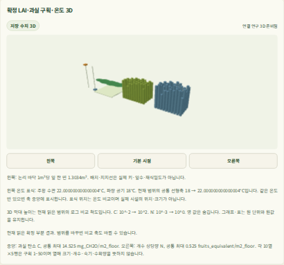

# v5 실제 계산 중 WebGL 부분 검증과 사용자 화면 복구 — 2026-10-11

**정상·hold의 계산 중 수치3D를 실제 제품 브라우저에서 확인했다. 취소 검증이 남아 P6a/P6b는 미완료이며 사용자5174의 계산 중3D는 비활성이다.**

[기계 증거](artifacts/crop-climate-joint-prefix-browser-v5-reference-20261011.json)의 SHA-256은
`750db6274161d56c5a35e3bd964c5d9139ca859fc370b67401b82c5a82600df7`이다.
기존 [reader v5의 고유267개 수용](crop-climate-joint-prefix-read-cost-implementation-20261011.md)을 유지한다.
이번에는 제품 계산/reader/UI를 변경하지 않았으며 reference Python/JS2파일을 보완했다.
native Codex CLI `gpt-6.1-sol`/`xhigh`의 기록 context SHA는
`e23b3f4ca7216bf8f3e87b8c0016f87e3e0a4813ce8f6a50fda90d2e2a110849`이고 재귀 CLI 실행은0이다.

## 실제 관측

같은 제품 core `aa61931`과 기존 P6a0 빌드171자산을 사용했다.5회 모두 backend/app203파일·web/src115파일의 해시가 같다.
실제 SCRAM/TLS API·자동 worker(chunk8)·제품 App/Chromium이며 API mock/worker 정지·지연은 없다.
경로별 reference 해시를 별도로 기록했다. 마지막 취소 재시도 분기는 정상/hold 검증 이후 추가했으므로
**최종 helper 전체가 세 경로를 모두 통과했다고 보고하지 않는다.**

| 실제 경로 | 결과 |
| --- | --- |
| 최초 정상19557 | running WebGL 관측, terminal 사건을 자동 조회한다고 가정한 harness assertion 실패 |
| 정상49259 | exit0; 같은 선택자 사건/생장200·running WebGL·원 terminal·재접속·현재 권리 철회/복원 통과 |
| hold7699 | exit0; running WebGL·원 사건/생장/UTC·terminal hold·재접속 통과 |
| 최초 취소73072 | 취소503 뒤 작업 succeeded; 취소 수락0, timeout 실패 |
| 취소 재시도16786 | 503 뒤 UI 재시도200도 cancel_accepted=false/cancel_requested=false·succeeded; browser RSS soft limit, 미수용 |

정상/hold에서는 빈 화면에3D가 없음을 먼저 확인하고 실제 확정 prefix를 읽었다.
LAI·50과실 구획·온도의 원 수치/UTC와 표·그래프·실제 WebGL을 대사했다.
terminal의 기존 **관리 사건 보기** 버튼을 사용해 사건을 읽고 prefix 행과 원 terminal 행/binary64/UTC가 같음을 확인했다.
이후 저장 시점과 같은 결과의 재접속을 확인했다. 임의 애니메이션을 생성하지 않았다.

정상 경로에서는 소유 합성 입력의 현재 권리 정책만 일시 철회했다.
실제422 `joint_research_hold`와 기존 장면 제거를 확인한 뒤 원 파일 bytes/mode를 복원하고 같은 저장 결과를 다시 조회했다.
원본2,148항목에 해당 정책 파일이 포함되지 않음을 먼저 확인했고, 복구 검사에서 원 현재 권리/키를 다시 대사했다.
PAGE error는0이다. 예상503/422 resource console 메시지와 GPU ReadPixels 경고는 별도로 기록했으며 숨기지 않았다.

위 PNG는 정상49259의 실제 패널 캡처를 수정 없이 복사하고 육안 확인했다. 연구용 수치 모식도이며 사용자5174의 현재 화면 캡처는 아니다.

## 남은 취소·자원 검증

최초 취소 실행의 같은 PG 로그에는 `SELECT jobs FOR UPDATE`의 statement timeout이 있다.
API 내부 stack은 추적하지 않았으므로 취소503의 정확한 내부 발생 줄은 확정하지 않는다.
기존 UI는503 이후 같은 취소 버튼으로 재시도할 수 있다. reference에 최대3회 재시도와 실제 서버 수락/작업자 canceled 확인을 추가했지만,
이번 재시도의200은 이미 succeeded인 작업의 **취소 미수락** 응답이었다. HTTP200만으로 취소 성공을 세지 않는다.

마지막 실행은 browser 내부 RSS soft limit으로 중단됐다. 외부0.25초 관측 단일/합산411,058,176/1,026,830,336bytes는
512MiB/1GiB 이내였으며 서로 다른 관측을 하나의 원인으로 단정하지 않는다.
원16786 tool 핸들은 재개 시 없어 tool exit를 null로 기록했다. immutable guard child1/browser1/service0·controller 종료/보존·정리를 직접 확인했다.

다음 한 단계는 취소 요청이 terminal 전 실제 수락되고 worker가 canceled를 확인하는 경로의 진단·검증이다.
worker를 늦추거나 메모리 한도를 올리지 않는다. 통과 조건은 같은 원 prefix/WebGL 이후 실제 취소 수락·장면 제거·terminal 결과 미생성,
실제 종료와 소유 정리·WSL/원본 보존·두 사용자 화면 복구다. P6a 전체 통과 뒤에만 P6b 사용자 적용을 진행한다.
5회 browser guard 합계815.117초이며 준비·실패 분석·복구/기록은 별도다.
다음 진단0.5–1집중시간을 잠정 배정하고 수정 범위가 확인되면 잔여 일정을 재산정한다. 사용자 계산 중3D 완료 날짜는 아직 확정하지 않는다.

## 사용자 화면 복구

두 기존 서비스는 활성/대기 공동 계산0을 확인한 유지보수 창에서 정확한 소유 프로세스만 정상 종료했다.
기존 joint/legacy 원 tool21652/74892의 exit0을 확인했다. 실패한 후보를 수용하지 않고 두 frozen source/자산으로 복구했다.

2026-10-11 **19:08 KST**에5173/5174의 HTTP200·원 HTML 해시와 보호 root4의 생존을 확인했다.
legacy의 인증된 원 생장/수확 조회 probe50514 exit0, joint의 원7응답/이전 토큰401/새 worker 시도0을 확인했다.
복구 query67578/integrity69854는 모두 실제 tool/guard exit0이며 원본2,148·두 frozen source/자산·FD4→4·소유 잔여0을 확인했다.
유지보수 전 jobs104/job_events249/job_attempts22행과274파일·키/DSN/현재 권리를 그대로 보존했다.
현재 지속 서버62256/73699는 실행 중이며 종료된 검증으로 세지 않는다. 임시5175는 닫혔다.

새 접속 안내는 [web README](../web/README.md#joint-execution-user-preview)의 `run-v8`/`serve-v8`다.
5173은 완료166일 저장 재생,5174는 같은 사용자 DB의 상태/확정 checkpoint 자동 조회·종료 후3D다.
5174 polling은 이전 응답 완료 뒤10초를 기다린다. 별도 개발 DB의 계산은 사용자 화면에 자동 노출되지 않는다.
현재 사용자 계산 중3D/최종 통합 UI·실제 작기/생산/미래 마진/추천은 미수용이다.
실제 농장 Run/국내 독립 자료0, G0–G4 `not_assessed`를 유지한다. 전체 CI·remote·전체 작기 재계산·새 제품 build는 실행하지 않았다.
