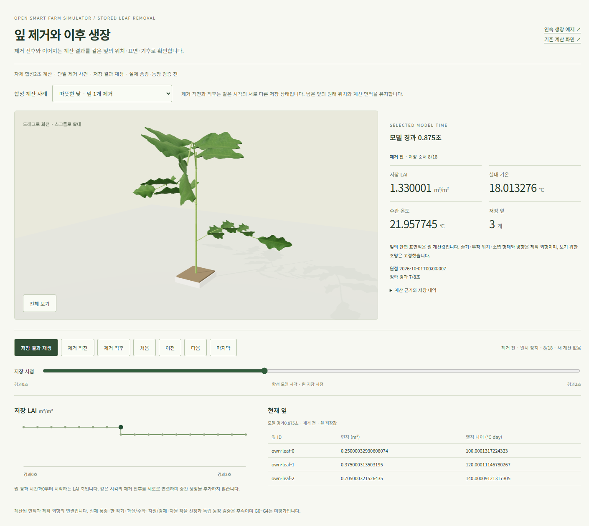
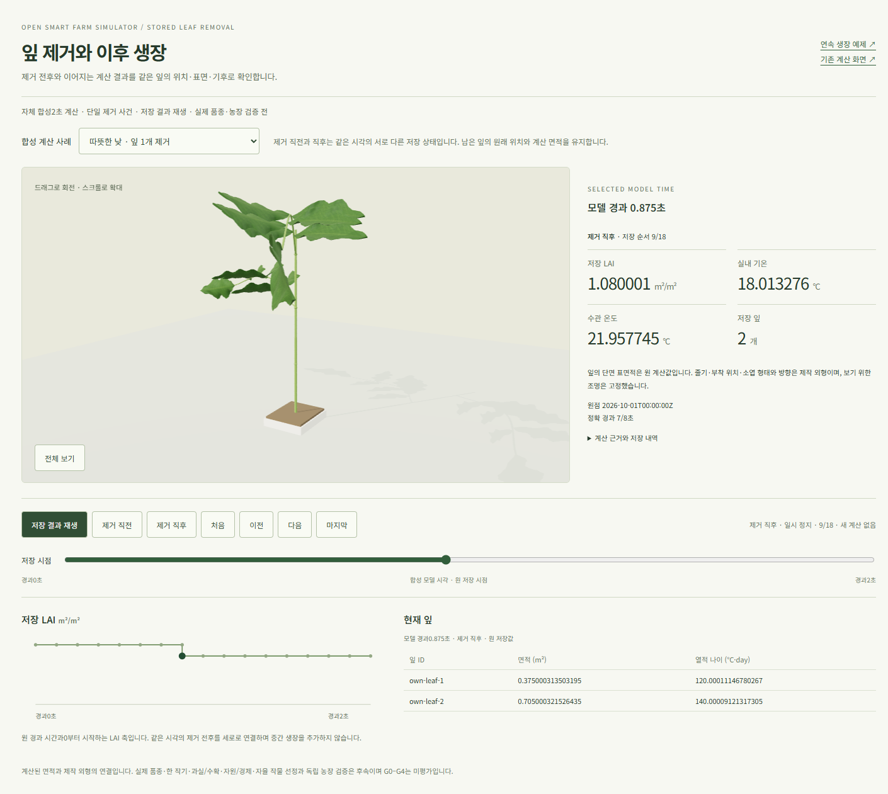
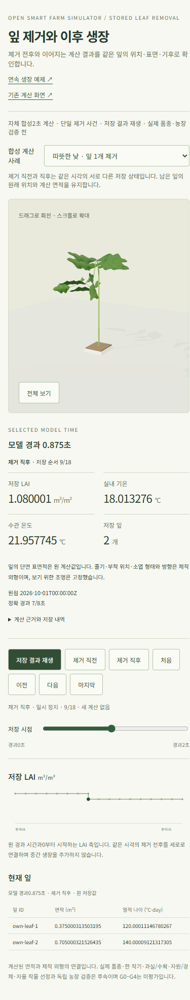

# 제거 전후 저장 상태의 잎3D 연결 — 2026-10-24

상태: **화면 소프트웨어 수용/로컬 적용; 실제 표시 창의 최종 확인 보류**.
[새 화면](http://localhost:5176/growing-geometry-removal-replay.html)에서 `제거 직전`/`제거 직후`를 누르면
같은7/8초의 원3잎과 남은2잎/1잎·현재 면적/기후/표/그래프를 확인한다.
자체 합성2초의 단일 사건이며 실제 품종·한 작기 예측이 아니다.
[계약](../contracts/growing-geometry-removal-3d-v1.md),
[페이지](../web/src/GrowingGeometryRemovalReplayPage.tsx),
[renderer](../web/src/growingGeometryPlant.ts),
[scene](../web/src/GrowingGeometryScene.tsx),
[브라우저 시험](../web/e2e/growing-geometry-removal-replay.spec.ts),
[기계 증거](artifacts/growing-geometry-removal-3d-20261024.json),
[468면적 장부](artifacts/growing-geometry-removal-3d-20261024.csv).

## 표시와 원 계산의 경계

[SDK의12결과/216시점](growing-geometry-removal-sdk-20261024.md)을 재계산 없이 읽는다.
기존 PBR 재질·잎맥/복엽·그림자를 재사용하고 남은 잎을 원 ID의 제작 부착 위치에 연결한다.
leaf1은 원0.95m/yaw2.8 위치를 유지하며 제거 뒤의 새 index0 위치로 옮기지 않는다.
원 A에 맞춘 실제 삼각형 합계를 대사했다. 줄기1.6m/부착·pose와 소엽 모양은 제작 자산이다.
높이/과실·숙기/수확·자원/마진이나 새 중간 생장을 만들지 않았다.
제거 전후는 같은 시각의 다른 flat index/phase이며 시간축의 점도 같은 x·다른 y다.
원 ID/면적·열적 나이/LAI·실내/수관 온도와 같은 시각·phase를 표/요약/scene에서 보존한다.

## 통과한 검증

- **신규 renderer37/위치26=63, 관련 SDK150/기존 renderer·위치34=184, 총247단위**와 전체 타입/build가 통과했다.
  모든18시점/사례의 원 ID·실제 면적/부착·복사본/정리, 잘못된 ID/순서/phase·면적/단위와 URL를 확인했다.
- **신규19+기존12=31브라우저**가 최종 코드에서 통과했다.
  새216시점/468표면과 기존102시점/306표면의 실제 면적·기본 투영0.98 이내·표/기후/phase를 대사했다.
  메뉴/reload/키보드·전후 버튼/동일 시각 그래프·모바일/유휴0·취소/늦은 응답/변조 재시도·WebGL fallback을 확인했다.
- 최종 실제 Chrome GPU에서 포커스 모사를 켠 상태로 **216시점/468표면**을 대사했다.
  최대 면적 상대차 **8.43769498715119e-15**, 원648파일의 실제702응답 bytes/hash가 같았다.
  추가54응답은 같은 사건 직후의 reload이며 POST/콘솔 오류·경고0이다.
  원 시각/phase/부착·표/그래프·유휴0/모바일 overflow0을 확인했고 포커스 모사를 해제했다.
- 기존1303파일의 metadata/bytes와 DB/키·4서비스를 보존했다.
  첫 새 entry/648원 파일과 별도 자산을 추가한 뒤, 최종 카메라는 자기 새 entry만 버전2 자산으로 교체했다.
  그때 이전2104파일(자기 entry 제외)의 metadata/bytes도 같았다. 원 private False와 SDK648파일은 그대로다.
  새 사용자 서비스/DB·키 재시작은 없으며 기존 preview의 유한 수명을 연장하지 않았다.

최종 타입/단위/build guard는11.781초·최대PID533,090,304bytes/합산921,104,384bytes,
최종31브라우저는88.238초·78,491,648/428,015,616bytes,
최종 GPU 대사는25.441초·78,491,648/405,991,424bytes였다.
512MiB/PID·1GiB 소유+보호 합산·0.25초 표본/600초/로그4MiB는 유지했다.
원/소스·4root·FD4→4·소유 잔류0을 보존했다. 새 entry 교체는 별도 소유 게시 스크립트로 수행했고
그 PID 최대RSS는29,584KiB였다. 이 게시의 합산 RSS 표본을 guard 측정처럼 주장하지 않는다.
Windows Chrome/Node·전체 host 용량은 WSL 측정 밖이다. 전체 backend/hosted CI는 이번 자식에서 실행하지 않았다.
Vite의 기존500kB 초과 chunk 경고는 남아 있다.

## 실패 기록과 실제 창 보류

첫 신규63의 RED 뒤 첫31브라우저 시도는18통과/1실패/12미실행이었다.
모바일에서 한 잎으로 시작했다가3잎으로 돌아갈 때 카메라가 잘렸다.
고정 중심만의 첫 수정도 실패했다. 전체 box로 맞춘 판본은 통과했지만 작물이 너무 작아
실제 잎 투영으로 조정하고 **최종247/31을 다시 통과**했다. 허용차나 원 A를 바꾸지 않았다.

초기 실제 Chrome은 포커스 모사 때문에 최소화의 숨김 확인이 실패했다.
이전 box 카메라의 하네스는 모사 해제 뒤 숨김 정지 통과를 기록했다.
모사 해제 직후·최소화 직전의 실제 표시 상태 관측도 부족하므로 이 기록을 최종 카메라의 통과로 쓰지 않는다.
후속 최종 확인에서는 전용 창이 normal이고 focus가 있어도 document.hidden으로 관측됐다.
PID·생성 시각/격리 profile을 대사했고 창 활성화 뒤에도 같은 상태였다. 원인을 화면 잠금 등으로 단정하지 않는다.
그래서 최종 GPU 렌더링 검사는 포커스 모사를 명시했고 끝나고 해제했다.
**모사 없는 최종 표시 창·실제 최소화 정지는 아직 보류**이며 부모 작업의 체크박스를 유지한다.
이는 전체 goal의 blocked 판정이 아니며 다음 모델 개발/자료 확보를 병행한다.
[CDP 포커스 모사](https://chromedevtools.github.io/devtools-protocol/tot/Emulation/#method-setFocusEmulationEnabled)와
[Windows 창 활성화](https://learn.microsoft.com/en-us/windows/win32/api/winuser/nf-winuser-setforegroundwindow)의 공식 계약 및 설치된 Playwright의 구현을 확인했다.

## 화면 비교와 남은 범위

원 승인 LayerDoc SHA `a6a0f14e13ff9e34cae3a1b8adfc0dbf0aa6c72cbc07887bd04e4ba63b213498`를 바꾸지 않았다.
12ui에서 실제 전/후·모바일 capture3개에 capture/convert/plan을 수행했고 가격 상한/구매0을 확인했다.
첫 image 입력의 --repo 오용과 dry-run의 JSON 출력 뒤 trailing 오류는 보존했다.
최종3개 kit는 settled, 무구매/0비용이며 unanchored/DOM coverage0이다.
계획의 정적 식물/그래프 raster와6잎·24h 목표는 이번 원3→2/1잎·2초/실제3D 요구와 달라 적용하지 않았다.
기존 색/글꼴·패널/실제 잎 재질을 유지하고 실제 capture와 승인 이미지를 비교했으며 픽셀 정합/R2를 승인하지 않는다.

native Codex CLI `gpt-6.1-sol/xhigh`, turn_context2026-10-24T13:26:29.981Z,
원 LF SHA `fb9b618e554dc633c13dc871d2c7cbb83aaa691caed5b67bb4f4a6376fb4e456`·재귀 CLI0이다.
화면 소프트웨어는 적용했으며 앞선100–180집중분 예상의 구현 부분은 이 증거로 대체한다.
모사 없는 실제 창 검증은 표시 상태 회복 후 같은 고정 결과로 약10–20집중분을 예상하지만 달력 완료일은 정하지 않는다.
이를 기다리는 동안 기존 출현·공급/관리와 새 a/A·C/N/현열 문맥의 누락 의존성을 대조해 다음 계산 하나를 정한다.
실제 계수/공급/빈 수관·복수 사건/전체 작기·생산/자원/Decimal 경제·거시/수급·자율 비교와
farm/실제 CLI G1·국내 원 측정/미사용 독립 작기0·첫 품종 미확정·R2/G0–G4는 남는다.
전체 goal은 미완료이며 전체 완료일은 미정이다.
