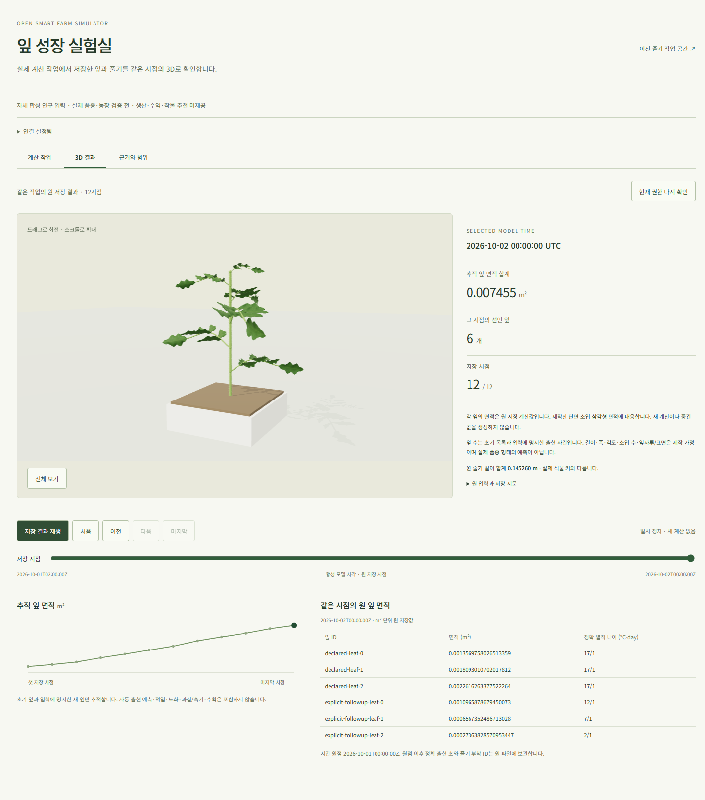

# 새 잎 계산의 실제 자동 3D 연결 — 2026-10-23

상태: **자체 합성 입력의 기능 경로 수용. 계산 중 일시적503의 원인·운영 무오류 수용은 보류**.
[사용자 화면](http://localhost:5176/leaf-population-execution.html?job_id=74693d03-9259-4f07-83a5-39063c8bb511),
[기계 증거](artifacts/leaf-admission-live-automatic-20261023.json),
[호출부 수정/160검사](leaf-admission-registration-scope-20261023.md)를 함께 확인한다.

## 실제 동작과 수용 범위

현재 SDK에서 입력 확인→새 계산 버튼 한 번→실제 자동 worker→저장 결과3D를 확인했다.
새 job `74693d03-9259-4f07-83a5-39063c8bb511`은 attempt1로 완료됐다.
수동 복구나 추가 POST 없이 마지막 시점을 표시하고 새로고침 뒤 같은 result/최초 계산 시각을 복원했다.
실제 권리 철회422 때 canvas·표·그래프를 제거하고 원 정책 bytes 복원 뒤 같은 job/root/마지막 시점을 읽었다.

같은 물리 DB·입력/서명 키·소스·인증으로 leaf 소유 API/PG를 완전히 내렸다 다시 기동했다.
재시작 전후25표 전체 SHA는 `12ed8ed1618e3ae7a2f323445573b1e08222e71c0eaa0b1ad763ae57c9665ab5`로 같았다.
원 줄기 DB25표 SHA·서명 파일74개·키도 보존했다. 재시작/복원 중 POST는0이다.
재기동 뒤 실제 Chrome에서12시점/52면적·UTC/기관 ID와3D 삼각형 면적·표·그래프를 대사했다.
면적 최대 상대차는7.31e-15 미만이며 메뉴/reload·저장 재생·유휴 정지·모바일을 확인했다.
이 재생 검증의 JS/console 오류는0이다. 새 프로필의 첫 GPU 셰이더 경고 검증을 대신하지 않는다.

| 실제 요청 | 응답 | 전체 본문 시간 |
| --- | ---: | ---: |
| 원 입력 확인 | 200 | 13.089초 |
| 새 접수 | 202 | 13.306초 |
| 실제 worker가 simulating/attempt1일 때 같은 POST | 202, 같은 job | 18.169초 |
| 완료 결과 재생 | 200 | 13.399초 |
| cold restart 뒤 화면의4개 status/replay | 모두200 | 최대13.828초 |

동시 retry 시험의 job은 `16b95f72-7812-4585-b88c-f5f16472efa0`이며 최종 succeeded/attempt1이었다.
이 API 시험 중 UI polling은 없었다. 별도 새 UI 시험은 자연스러운 worker+browser polling이며
동시에 외부 동일 POST를 추가하지 않았다. 세 부하를 합친 용량이나 다중 사용자/G4 수용을 주장하지 않는다.
gateway까지는 localhost HTTP이고 gateway→API는 인증서 검증 TLS다. 독립 소프트웨어 시험은 직접 검증 TLS다.

## 변경·실패 이력과 남은503

호출부 코드 `6bad7dd`를 기존 query `7d9c289`/원 `4f1f523` 기반의 별도820파일 snapshot에 적용했다.
실행 소스는6bad7dd와 같고 원 실행 계약 문서 한 개는 역사 판본을 보존한다. 전체 git checkout은 아니다.
현재 원천4,864회/등록64회는 유지하고 요청당 등록 재구성만1회로 줄였다.
수치 모델·서명 authority·worker·접수 core와 기존 intent/result는 바꾸지 않았다.

첫 관측의 잘못된 active 상태명과 두 번째 관측의 출력 파일 충돌은 시험 실패로 보존했다.
다음 동일 POST 관측에서는 성공 header 단정 때문에 HTTP status를 수집하지 못했다.
같은 시각의 PG는 reserved connection slot 소진을 기록했다. 이를504나30초 초과로 단정하지 않는다.
실제 max_connections8/reserved3은 일반 연결5개뿐이었다. 근거에 따라 owned PG만12로 조정했다.
shared_buffers4MiB·HTTP30초/2MiB·WSL512MiB/PID/합1GiB는 유지했다.
앞선 실제 접수 작업도 삭제하지 않았고 모두 attempt1 완료로 보존했다.

새 UI 자동 경로에는 **status503 두 건과 해당 console 오류 두 건**이 있었다.
기존의 제한된 GET 재조회가 수동 조작 없이 회복해 완료3D를 표시했다. JS 예외는0이었다.
해당 v8 PG 로그의 FATAL/ERROR는0이지만 이것만으로 원인을 확정할 수 없다.
현재 query는 읽는 동안 job bundle이 달라질 때 Pending을 내고, HTTP는 Pending/그 밖의 내부 오류를
같은503으로 투영한다. 본문을 얻지 못한 두 응답을 사후에 특정 Pending으로 확정하지 않는다.
당시 다음 작은 진단은 별도 합성 새 작업의 실제 무중단 worker/상태 조회에서 예외 분류와 요청 시점을
비공개 값 없이 대조하는 것이다. 필요한 수정은 관측 뒤에만 별도 제안한다.
원 사용자 경로/시간/현재 권리·수치 코드와 생산 관문은 유지하며 운영/clean console은 계속 보류한다.

실제 API/UI/권리/cold browser의4개 guard는 모두 종료0·소유 잔류0·FD4→4였다.
원3root·감시2,481항목/소스·기존 URL을 보존했고 합산 최대 RSS는477,335,552bytes였다.
Windows Chrome 메모리는 WSL 합계에 포함하지 않았다.
전체 backend/새 hosted CI는 실행하지 않았다. 웹 코드는 변경하지 않았으며 같은 웹 source의
기존 CI39925213943/단위2,008·브라우저296 통과를 새 실행으로 합산하지 않는다.
판단은 현재 native CLI gpt-6.1-sol/xhigh이며 재귀 CLI0이다.

## 다음 제품 단계와 외부 의존성

사용자가 확인할 산출물은 위 실제 새 작업3D와 불변 결과/현재 권리·재시작 증거다.
현재 잎 수는 초기 목록과 **명시 출현 사건**이며 자동 출현·적엽/노화 예측이 아니다.
다음 계산 단계는 기관/잎 출현과 관리의 문헌 근거·단위/정책을 확인한 작은 결정론 모듈로 분해한다.
그 뒤 저장 결과/같은 UTC3D, 생산량→자원→Decimal 경제를 차례로 연결한다.
그 전까지 과실 외형을 계산된 착과·숙기·수확으로 표시하지 않는다.

503 원인 진단은 준비0.25–0.5시간 + 실제 관측0.25–0.5시간 + 대사/기록0.25–0.5시간의
**0.75–1.5집중시간** 잠정 작업량이다. 약284초의 새 UI 경로·약192초의 API 경로 실측이 근거이며
수정이 필요하면 따로 분해한다. 다음 출현/관리 근거 검토는 기존 자료 대조1–2시간 + 계약/수용 분해0.5–1시간의
**1.5–3집중시간**으로 배정한다. 검토 전 구현 완료 날짜를 확정하지 않는다.
Axiany 실제 계수/forcing·독립 작기 확보0은 합성 개발과 병행한다.
생산/자원/경제·수급/거시·자율 작물 비교·최종 사실감 R2/제품 UI·G0–G4는 미완료이며 전체 완료일은 미정이다.

## 별도 실제503 분류 진단

[독립 진단 증거](artifacts/leaf-status503-natural-diagnostic-20261023.json)를 수용했다.
별도 SCRAM·검증 TLS/owned 실행 파일과 정상 자동 consumer에서 새 합성 작업을 한 번 접수했다.
PG12/reserved3/4MiB·HTTP30초와 현재 수치/worker·조회 소스를 유지하고 별도 observer만 적용했다.
관측은 예외 종류·두 원 bundle의 상태/변경 열 이름·사건 종류/건수뿐이며 원 입력·키/토큰/SQL은 기록하지 않았다.
인위적 worker 정지/장벽이나 추가 DB 조회를 넣지 않았다.

상태 조회10개 중 두503은 각각 `LeafPopulationExecutionQueryPending`과 일대일 대응했다.
첫 조회는 queued→simulating/attempt0→1, 두 번째는 simulating→succeeded와 원자 결과/사건/완료 참조 변경이었다.
그 밖의 일반 내부 오류는0이며 이후200/완료 attempt1·원12frame/52면적을 확인했다.
별도 진단 요청 최대18.435초는 계측 실행 관측이며 정상 성능 수용으로 더하지 않는다.
완료 뒤 읽기 전후25표와 새 job 제외 원25표가 같았고 실제 실행/PG·역할/스키마를 정리했다.

첫 두 observer 준비 오류(JobStore/config 혼동, dict-row SHOW 접근)는 executable/POST 전 실패로 보존했다.
최종 guard284.366초·합산 RSS644,116,480bytes/소유 잔류0·FD4→4·원3root/2,481항목/소스를 보존했다.
사용자 runtime/DB/화면과 제품 코드는 변경하지 않았다. 전체 backend/새 hosted CI도 실행하지 않았다.
이 진단은 정상 상태 전환에서의 Pending과 복구를 설명하지만 이전 사용자 두 응답을 사후 확정하지 않는다.
기존 제한 GET 복구와 원자 현재성 검사를 유지하며 추가 기반 변경은 하지 않는다.
위0.75–1.5시간 진단 계획은 실제 수용으로 대체하고 다음 작물 계산/출현 정책을 진행한다.
