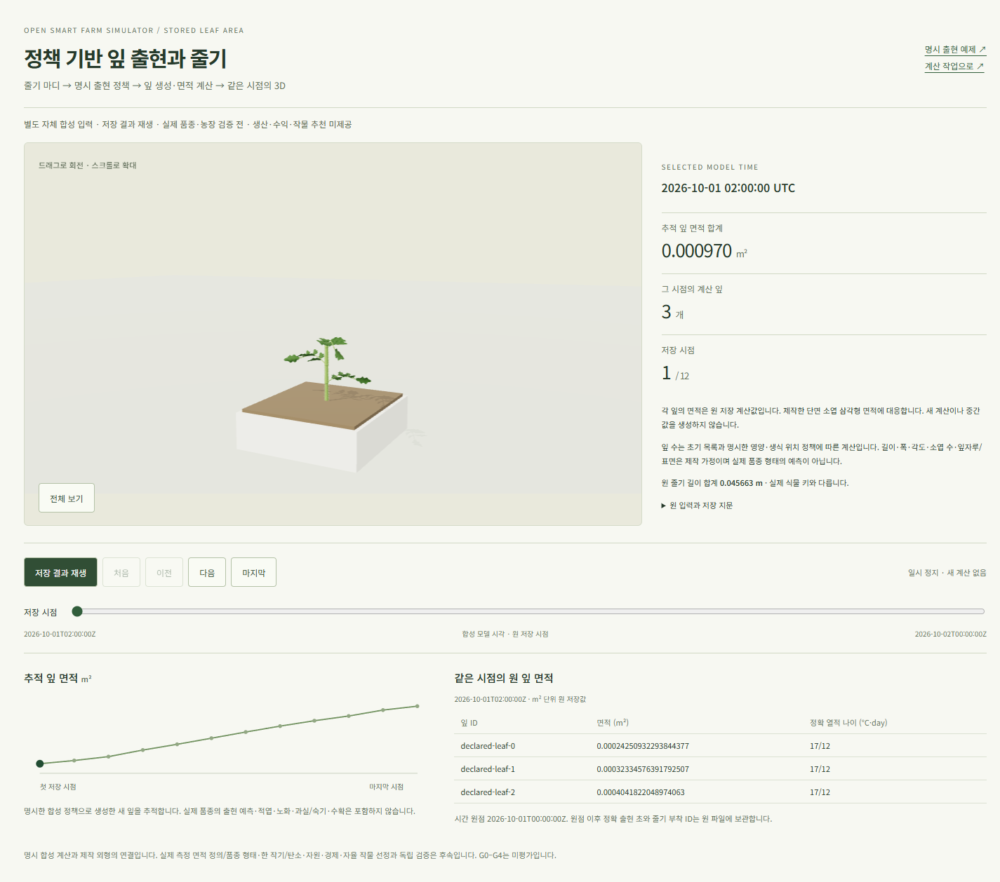
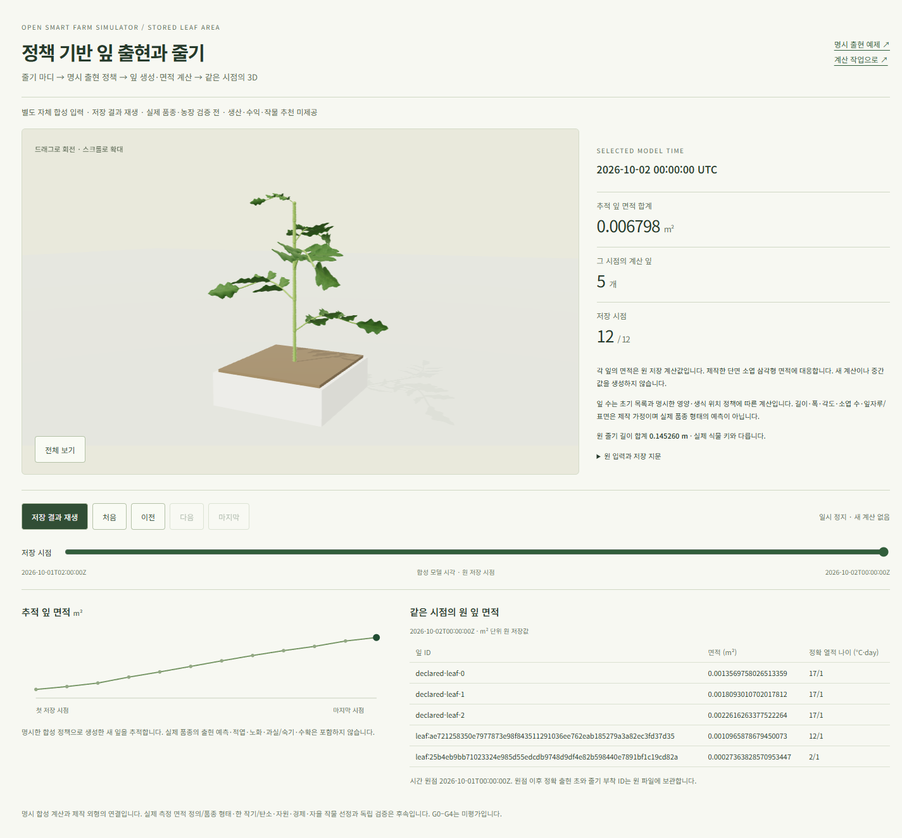
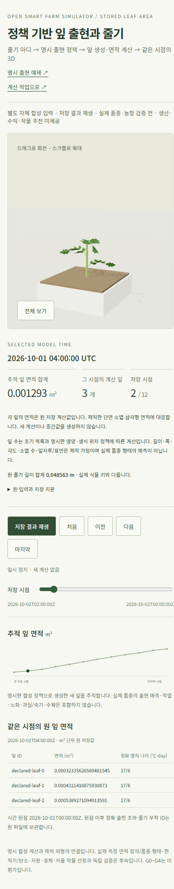

# 정책 기반 잎 출현의 저장 3D — 2026-10-24

상태: [표시 계약](../contracts/web-leaf-appearance-replay-v1.md)의 **자체 합성 연구 UI 기능 수용**.
[새 화면](http://localhost:5176/leaf-appearance-replay.html)에서 `저장 결과 재생`을 누르면
같은 저장 UTC의 줄기와 명시 정책으로 계산한 **3→5잎**을 확인한다.
이 화면은 기존 농장 job의 자동 계산 화면과 별도이며 실제 품종의 출현·생산 예측은 아니다.

## 계산 결과와 실제 화면

[strict SDK](leaf-appearance-sdk-20261024.md)의 원20파일만 읽고 기존 page/renderer/geometry를 재사용했다.
outer root는 `77c3ffcab5f02b0dab132530a3f4c278db07dd18a258633bb4b148c18f5e423a`이며
새 source의 원12시점·47면적/ID·부착/정확 나이·줄기 길이를 보존한다.
초기 목록과 명시한 첫 생식 순번4/그 사이 영양 위치2는 자체 합성 정책이다.
실제 Axiany 계수나 관측으로 채택한 값은 없다. 면적 정의·소엽 수/폭/각도/표면은 기존 제작 가정이다.

실제 사용자 URL의 Windows Chrome에서 **고유12시점/47개 면적**을 대사했다.
제작 단면 잎의 world triangle 면적과 원 m²의 최대 상대차는 **6.723195640234054e-15**로 계약1e-9 이내다.
3D/요약/표/그래프가 같은 UTC·원 수치와 ID를 사용하며 중간 생장·과실/숙기를 만들지 않는다.
초기20 GET, 전체 요청 GET·POST0, 애플리케이션 예외/콘솔 경고0을 확인했다.
이는 기존 전용 프로필의 관측이며 새 cold 프로필의 경고 해소 수용은 아니다.

URL에 고정 root/선택 frame을 보관하고 메뉴 이동·reload 뒤 같은 source/마지막 시점을 복구한다.
재생 시0부터 전진·일시 정지, 유휴1.2초 redraw0, 390×844 모바일 overflow0을 확인했다.
자체 합성 input의 권리/hash를 route로 바꾼 시험에서 장면·표를 제거하고 원복/reload 뒤 같은 시점을 복원했다.
이 시험을 서버의 실제 농장 권리 철회로 보고하지 않는다. WebGL 불가 시 원3→5잎 표만 유지했다.
별도 실제 회전/스크롤 확대는 canvas를 바꾸면서 원 UTC·면적·ID를 보존했고,
`전체 보기` 후 canvas PNG가 회전 전과 정확히 같았다. 소유 기본 프로필에 마지막/정지 화면을 열어 두었다.

| 첫 저장 시점 | 마지막5잎 | 모바일 재생/정지 |
| --- | --- | --- |
|  |  |  |

## 검증과 기존 서비스 보존

소스 `ab22fa22f1315d0aed1774791da71cb0fae8fd59`의
[전체 웹 CI39990002897](https://github.com/KIMSUNGHOON/OpenSmartFarmSim/actions/runs/39990002897)는
**49파일/2,082단위·Chromium299·타입·앱 build·audit high gate**를 통과했다.
새 viewer의 브라우저3개와 기존 화면 전체 회귀를 포함한다. moderate 취약점2는 남는다.
CI job120539022093/run 모두 completed/success와 같은 source HEAD를 확인했다.
전체 backend/별도 native CI는 실행하지 않았다. CI의 브라우저 API 응답은 기존 합성 시험이다.

로컬에서는 URL helper 부재 RED 뒤21단위, 최종 관련10파일/184단위·타입을 통과했다.
새 entry를 포함한 별도 minified multi-page build도 성공했다. 이 빌드와 실제 사용자 Chrome 검증은
CI 기본 앱 build와 별도 증거다. 기존 Three.js 외형 chunk811.17kB 경고는 유지한다.

5176의 기존 배포239파일을 덮어쓰지 않고 **새23파일만 추가**, 동일130파일은 건너뛰었다.
선택153파일의 HTTP200/원 SHA와 원239파일의 inode/권한/size/mtime/ctime/SHA를 대사했다.
원 API/nginx 설정·물리 DB/키/입력·기존 URL·보호3root를 보존했고 새 서비스는 만들지 않았다.
소유 phase는 PID512MiB/합산1GiB·600초·0.25초 표본/4MiB 로그 안에서 정리됐다.
가장 큰 최종 디자인 비교의 합산 RSS는865,591,296bytes였다.
각 phase의 원 파일/현재 소스 보존·잔여0·FD4→4와 예비 실패는
[기계 판독 증거](artifacts/leaf-appearance-stored-replay-20261024.json)에 보존한다.
Windows Node/Chrome 메모리는 위 WSL 합계 밖이며 공통 운영 용량 수용은 아니다.

12ui의 기존 LayerDoc을 재사용해 추가 구매 없이 capture/convert/plan을 끝냈다.
DOM67.6%/design78.1% 매칭 gate는 통과했지만 픽셀 정렬·최종 사실감 R2 수용은 아니다.
실제 WebGL/SVG의 raster 교체, 고정3잎/수치와 표 삭제 제안은 원 계산/조작 보존 요구와 충돌해 채택하지 않았다.
기존 CSS·직접 제작 외형/자체 호스팅 글꼴을 유지하고 실제 desktop/mobile 캡처를 검토했다.
초기 CLI 옵션/dry-run 오류와 Linux browser 부재 실패를 기록했고,
전용 캐시에 필요한 headless만 설치해 제한된 소유 프로세스로 비교를 마쳤다.
현재 정확 CLI `gpt-6.1-sol`/`xhigh`의 실제 turn_context 시각/원 LF SHA와 재귀 CLI0을 증거에 기록했다.

## 다음 한 단계와 남은 의존성

다음은 **자동 출현 원 입력의 출처·단위·현재 검토 결속**이다.
기존 population 입력 증거는 생성된 잎 선언만 검사하므로 새 outer 정책·초기 위치의 근거를 대신할 수 없다.
새 입력의 원 bytes/정책/프로필과 검증된 stem 입력을 같은 decision UTC에 연결하고,
rehash 뒤 정책/출처/단위 변조·현재/늦은 철회를 거부하며 별도 fresh의 생장 import/계산·DB·CLI·쓰기0을 확인한다.
기존 입력 증거/producer/reader의 원 지문과 완료 job/result·서비스는 보존한다.
그 뒤 현재 농장/완료 stem 결과→서명/자동 worker→같은 job의 API/3D 순서로 연결한다.
관측·농장 자료 확보는 합성 개발과 병행하며 이 증거를 실제 농장 승인이나 수치 검증으로 세지 않는다.

다음 자식의 기존 경계 대조/구현1–2시간, 반례·fresh1–2시간, 검토/기록0.5–1시간으로
**2.5–5집중시간**을 낮은 신뢰로 추정한다. 후속 farm/worker/API/UI·관리·자료 확보를 포함하지 않는다.
이번 UI 단계의 앞선1.5–3.5시간 예상은 위 실제 수용 기록으로 대체한다.
실제 품종 계수·국내 독립 작기0, 적엽/노화·전체 작기 탄소/생산·자원/Decimal 경제·거시/수급·자율 비교,
R2/기존 첫 cold 셰이더 경고가 남는다. G0–G4와 예측/미래 마진/추천은 미평가/보류이며
전체 완료 날짜는 외부 자료 확보 일정이 없어 미정이다. 전체 goal은 도구상 active를 유지한다.
