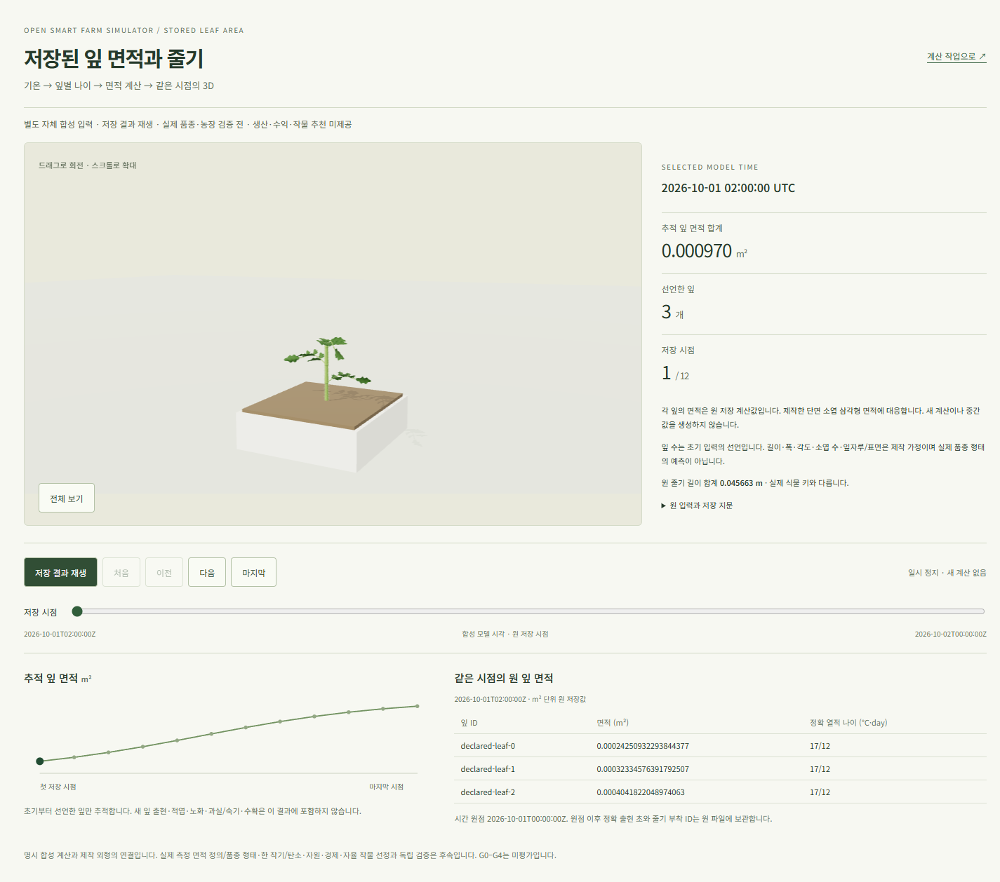
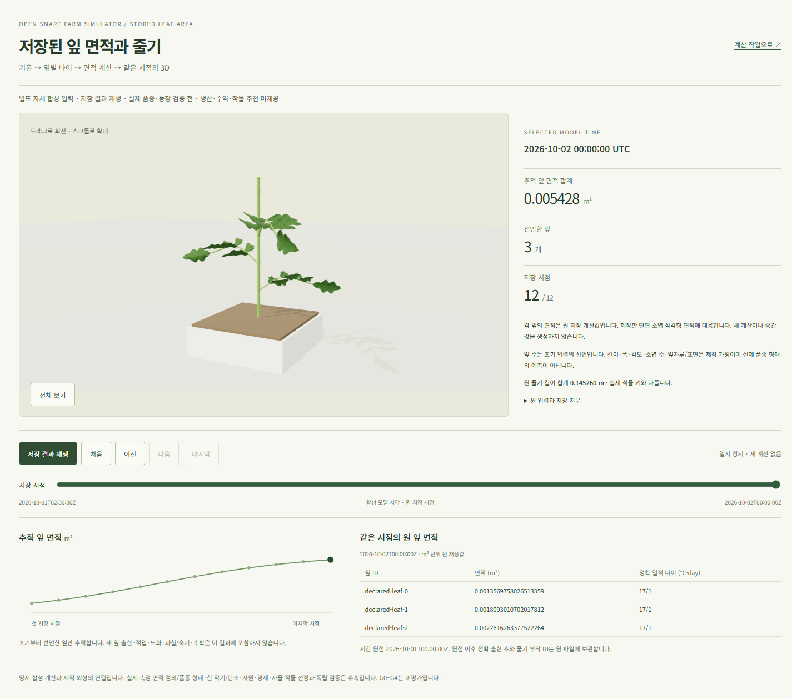
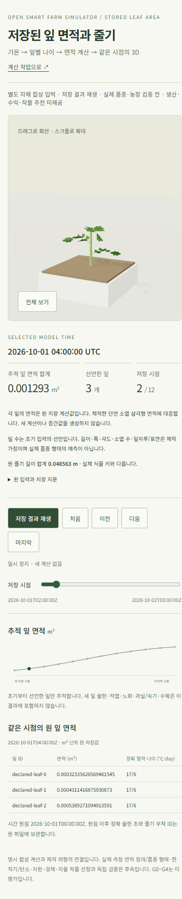

# 저장 잎 면적과 같은 UTC의 3D — 2026-10-22

상태: [표시 계약](../contracts/web-leaf-area-replay-v1.md)의 **자체 합성 저장 재생 수용**.
[사용자 화면](http://localhost:5176/leaf-area-replay.html)은 원 농장 작업 화면과 분리된다.
[불변 계산 결과](crop-leaf-area-artifact-20261022.md)의 12시점/선언3잎만 읽으며 새로운 생장 값을 만들지 않는다.

## 확인한 동작

저장 root `7ebcd02d902f03343e61e2151a93107d021404eed74071fa3e9bbe417743a8a5`와
원 index/입력·stem/각 DTO bytes를 SDK가 검증한다. 원 시각·leaf/부착 ID·면적·정확 나이를 유지한다.
실제 instance/world 행렬의 단면 소엽 삼각형 면적을 원 m2에 대응한다. 잎자루/중심축은 제외한다.
길이/폭·소엽 수·각도·표면은 제작 가정이며 실제 품종 형태나 관측 면적 정의의 검증이 아니다.

실제 Windows Chrome에서 첫/마지막과 재생·모바일·최종 선택5건을 원 파일과 대사했다.
3D/표/그래프/요약의 UTC와 원 면적·정확 나이/줄기 길이가 같았다.
삼각형 면적 최대 상대차는 **6.136198352556878e-15**로 계약1e-9 안이다.
첫/끝 canvas가 다르고 저장 재생→정지·유휴1.2초 frame 증가0·390px 가로 overflow0을 확인했다.
heading/button/table 접근성 구조와 오류/경고0을 확인했다. 모든 요청 GET이며 원 자료17파일·POST/API 요청0이다.
현재 창은 마지막 저장 시점/정지로 남겼다. 첫 ready639ms는 이번 환경의 단일 관측이며 성능 기준 수용이 아니다.

| 첫 저장 시점 | 마지막 저장 시점 | 모바일 |
| --- | --- | --- |
|  |  |  |

## 통과한 검사와 보존

소스 `22effe5c810ae9c066044325df2e3aff306ba5d0`의
[집중 CI39692294572](https://github.com/KIMSUNGHOON/OpenSmartFarmSim/actions/runs/39692294572)에서
타입·9파일/69단위·build·Chromium18(기존 외형/줄기/실행 포함)·audit high gate를 통과했다.
WebGL2 불가 때 원 표 유지도 hosted에서 확인했다. **audit의 moderate2는 남아 있다.**
RED의 SDK 부재와 첫 GREEN의 browser test this 타입 오류를 거쳐 수정 소스의 통과를 확인했다.
전체 backend/web 회귀를 실행했다고 주장하지 않는다.

CI 산출물 중 새27파일만 HTTP200/no-store·원 bytes SHA와 대사해 추가했다.
기존178파일의 inode/UID/GID/mode/size·mtime/ctime/SHA를 보존했다.
원5173/5174/5175/5176 응답200, backend/DB/nginx 설정 변경0이다.
새 build의 기존 진입 HTML5개는 보존하고 덮어쓰지 않았다.

WSL .25초/23samples·5.985초에서 7개 보호 root가 살아 있었고
단일PID peak124,948,480/합계1,032,454,144bytes로512MiB/1GiB 안이었다.
Windows Node/Chrome 메모리는 이 합계 밖이며 공통 용량 수용은 아니다.
첫 private 감독 스크립트의 Path/str 오류는 child 시작 전에 실패했고 수정 후 통과했다.
Chrome DevTools MCP가 없어 기존 격리된 소유 Chrome의 CDP를 사용했다. 다른 사용자 미리보기 탭은 유지했다.

## 다음 단계와 외부 의존성

현재 화면은 계산된 면적과 제작 외형의 연결이다. 초기 선언3잎 이후 새 잎·적엽·노화는 없다.
다음 작은 계산은 명시 출현 사건과 잎별 나이0/초기 면적을 연결하고 남은 구간만 전진하는 것이다.
자동 leaf/truss 분류·품종 phyllochron은 별도 근거를 요구한다.
원 농장 작업의 현재 권리/서명·worker 결과에 새 잎 모델을 결속하는 작업도 남아 있다.
실제 Axiany 계수/초기관측·독립 농장 자료0, 한 작기/탄소·자원/경제·자율 작물 선정과 G0–G4는 미완료다.
최종 사실감 R2와 전체 제품 완료일은 이 검사로 확정하지 않는다.

정확 native `gpt-6.1-sol / xhigh`·재귀 CLI0과 [기계 판독 증거](artifacts/leaf-area-stored-replay-20261022.json)를 보관했다.
