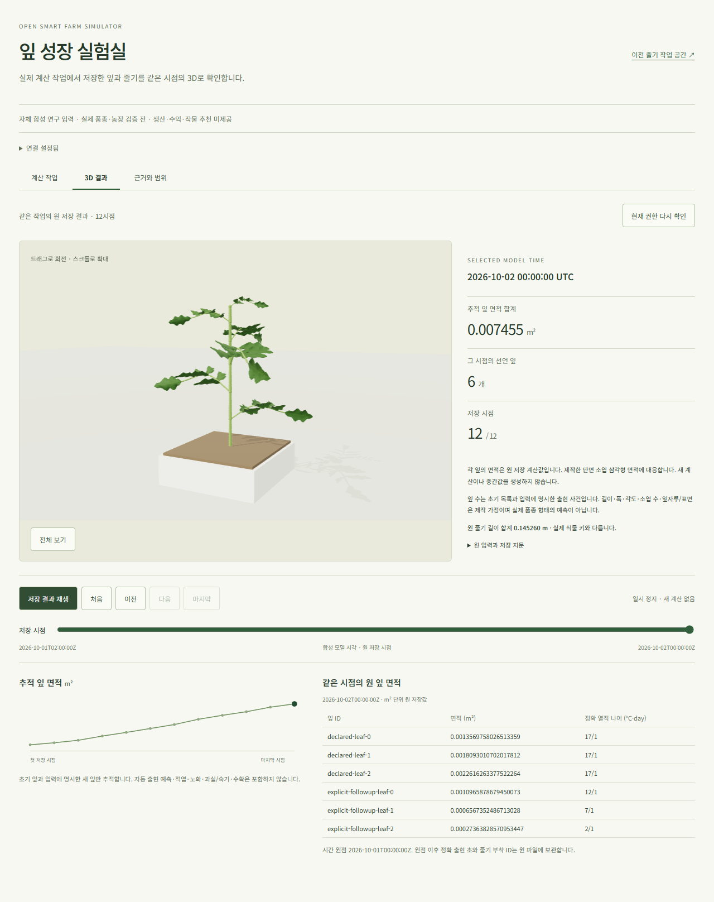

# 잎 실행 SDK·3D 화면과 실제 조회 보류 — 2026-10-23

현재 코드는 `f4a2f3ae88a1754f746ad832c14cd1744bf64506`이다.
[실행 화면](http://localhost:5176/leaf-population-execution.html)을 별도 추가했고,
strict SDK/상태·재접수·저장 시점 복구의 **소프트웨어 검증**을 수용했다.
실제 새 작업의 현재 조회는30초를 초과하므로 **사용자 전체 UI 경로는 미수용**이다.
[관측 JSON](artifacts/leaf-population-execution-web-20261023.json)과
[선행 live API 증거](leaf-population-execution-live-20261023.md)를 함께 읽는다.
기존 [새 잎 연구 재생](http://localhost:5176/leaf-population-replay.html)과 줄기 작업 공간은 보존했다.

## 구현과 확인 범위

- 실제 leaf API의 tenant/farm·parent job/result/root·최초 계산 시각·원 manifest/frame/기관 ID·정확 시계/면적을 검증한다.
  공개 fixture의 root/12시점을 동적 SDK의 정답으로 고정하지 않는다. 재배포 False도 서버가 허용한 표시만 소비한다.
- 진행 작업은 status만 읽고, 완료되면 replay를 별도 읽어 양쪽 결과 식별자가 같은지 확인한다.
  각 HTTP 요청의 기존30초·no-store/2MiB·인증/현재 권리 검사를 유지한다.
- 접수 응답 유실 뒤 같은 요청을 보관하고 명시 재확인한다. POST는 자동 반복하지 않는다.
  503 GET만 최대2회 추가 확인하며 오류 안내를 유지한다. 시간 초과·권리 거부는 자동 반복하지 않는다.
- 같은 작업·선택한 저장 시점을 메뉴/reload 뒤 복구한다. 새 접수 뒤 URL의 job_id도 갱신한다.
  조회/권리/무결성 실패 시 3D·표·그래프를 제거하며 static fixture로 대체하지 않는다.
- 기존 Three.js 잎·줄기 renderer에 원 UTC/면적을 연결한다. 임의 중간 시점/성장·과실/수량을 생성하지 않는다.
  새 HTML/해시 자산만 배포해 원227파일·기존 URL/저장 키를 보존했다. 기본 `/`는 이전 줄기 화면이다.

Vitest **53개**, TypeScript와 별도 appearance build가 통과했다.
Windows 전용 Chrome의 **14개** browser 검사는 새 실행10개·기존 두 잎 재생4개다.
원12시점/52면적의 실제 삼각형·표·그래프, 메뉴/reload, 504 접수 응답 유실,
취소, 표시 거부/복구, 모바일, 연결 해제, 새 작업 URL, bounded503을 확인했다.
이 browser 검사의 API는 모의 응답이며 실제 농장 검증이 아니다.
[전체 웹 CI39922931911](https://github.com/KIMSUNGHOON/OpenSmartFarmSim/actions/runs/39922931911)은
같은 f4a2f3a에서 단위2,008·타입/build/audit를 통과했지만 브라우저296중292번째 시작 시15분 job 한도로 취소됐다. 전체 browser 통과로 세지 않는다.
CI 작업 예산만 실측에 따라20분으로 조정한6ab6c38의 [전체 재검사39925213943](https://github.com/KIMSUNGHOON/OpenSmartFarmSim/actions/runs/39925213943)에서 **단위2,008/브라우저296·타입/build/audit**가 통과했다. f4a2f3a와 웹 코드/정적 입력이 같으며 CI budget만 다르다. 제품 HTTP30초와 WSL 검사의 예산은 유지한다.

## 실제 사용자 경로와 발견한 결함

이전 SDK의 완료 replay 직접 조회에서는 기존 job399c3c1a의12시점/52면적·원 UTC,
메뉴/reload의 마지막 시점, 재생·유휴/모바일·추가POST0과 브라우저 오류/경고0을 확인했다.
이는 현재 status-before-replay SDK의 전체 live 통과로 세지 않는다.

실제 UI에서 접수2·취소1을 수행했다. job74cb550e는 canceled/attempt0,
job ea2d7704는 succeeded/attempt1이며 원 결과는
`aa62ffd413f73e5f14eacc9071b73edd87b7b43bec6103c870a106c59d06fd3b`다.
처음 SDK가 미완료 작업에도 replay를 요청해422를 받았다.
[E3 계약](../contracts/crop-leaf-population-execution-v1.md)의 미완료 status 조건을 잘못 적용한 결함이다.
SDK와 모의 서버를 수정하고, 미완료 replay 거부와 status/replay 사이 결과 변경 거부를 회귀 검사에 넣었다.

수정 후 새 완료 job의 status는 실제 브라우저에서 약30초에 timeout됐다.
추가 디자인 관측 도구를 종료한 단독 실행에서도 재현됐다.
현재 SDK의 새 job3D/reload·실제 권리 철회→복구와 전체 UI 부모는 **미수용**이다.
초기 수집기의5초 대기/첫 시점 가정·CDP 연결 부재·응답 본문 수집 순서 오류도 별도 실패로 보존했다.
기존 계산 중 동일 POST30.028101초/504 보류를 이번 결과로 해소하지 않는다.

## 지연의 관측과 다음 후보

실행 중인 backend의 source4f1f523/820파일·DB/키는 바꾸지 않았다.
같은 factory를 별도 프로세스에서 구성하되 HTTP server/worker 시작 전에 중단하고,
동일 완료 job의 현재 query만 호출했다. 이는 **진단이며 HTTP30초 수용이 아니다**.

cProfile을 켠 status는53.404초였다. 누적 비용은 signed `_load`2회,
parent 확인4회, 줄기 binding current32회, 농장 등록 재구성64회로 이어졌다.
SQL execute33,055회와 runtime role audit1,423회를 관측했다. 프로파일 오버헤드는 빼지 않았다.

기존 `FarmAuthoringService.registration_read_scope`를 호출 바깥에 적용한 연구 전용 비교는
original → scoped → scoped → original 순서에서 각각
**34.921 / 13.782 / 13.961 / 31.862초**였다.
observed_at 외의 전체 status·원 결과/최초 계산 시각이 같고,
매번 scope 종료와25표 원 행 SHA 보존을 확인했다.
제품 코드에는 이 후보를 적용하지 않았다. 별도 shadow 권리 파일을 첫 leaf 권리 확인 뒤·마지막 replay frame 뒤 철회한4경우에서는 원/후보 모두 같은 Hold로 거부하고 scope를 정리했다. 원 live 권리 파일과25표는 보존했다.
다른 source/등록/parent/actor 변경·동시 취소/게시와 실제 HTTPS는 아직 시험하지 않았다.
시간 개선만으로 권한/현재성 동등성이나 운영 수용을 선언하지 않는다.

다음은 [이 작은 scope 후보 계약](../contracts/leaf-population-query-registration-scope-v1.md)의 나머지 반례 검사 → 현재 query의 최소 수정 → 독립 실제30초 검증 → 새 job3D다.
한 작기/생산·자원/경제·자율 작물 선정은 그 뒤이며, 실제 Axiany/독립 현장 자료 확보는 병행한다.

## 자원·설계·남은 조건

보호 WSL3root와 소유 검사 프로세스를0.25초마다 관측했다.
수용한 마지막 타입 검사의 합산 peak907,796,480bytes, PID480,944,128bytes였다.
원25표 SHA019e364e·backend820파일·원 자료와 소유 잔여0/FD4→4를 확인했다.
Windows Chrome 메모리는 WSL 수치에 포함하지 않는다. WSL browser의 실행 파일 부재/1GiB 초과는 실패로 보존했다.
전체 backend·일반 WSL/운영 용량·현재 UI 전체 live 수용을 주장하지 않는다.

12ui branch의3상태/4HTML을 받고 원 화면·레이아웃/현재 UI를 대조했다.
prototype은 WSL1GiB 초과로 미완료다. 후속 screenshot 기반 improve의 변환/계획은 완료됐지만
**unanchored**이며 recurring token patch는 없다. URL/DOM에 결속한 최종 R2는 미수용이다.
생성안의 식물 이미지·가상 수치 그래프·내보내기·잎 개수 입력은 실제 계산/권리 계약과 달라 적용하지 않았다.
원 이미지/변환·키트와 실패를 비공개 상태 디렉터리에 보존했다.

키트의 지출 원장은 다음과 같다. 같은 stage ceiling을 purchase별로 합산하지 않는다.

| purchase | stage | invocation | price ceiling |
| --- | --- | --- | --- |
| c9b14eaf-6b1d-464e-b98c-6f4223a894ba | convert | improve pid 3568790, started 2026-10-23T07:47:30.216Z | $0.55 (stage ceiling, shared by 2 purchases) |
| e4828e44-4f5e-42da-94a2-2417c48db7a6 | convert | improve pid 3568790, started 2026-10-23T07:47:30.216Z | $0.55 (stage ceiling, shared by 2 purchases) |

2 purchases/1run의 distinct ceiling은 총$0.55이며 실제 정산 가격은 키트에 없다.
선행 branch의 각 conversion/purchased viewport ID도 관측 JSON에 기록했다.

조사·설계는 native Codex CLI의 실제 turn context2026-10-23T06:59:00.601Z,
**gpt-6.1-sol/xhigh**에서 수행했다. 재귀 Codex CLI는0이며 원 context line SHA와 출력 지문을 관측 JSON에 보관한다.
실제 품종/독립 작기0·승인 farm Run0, 첫 cold shader 경고·최종 R2/G0–G4와 전체 완료일 미정을 유지한다.
goal은 이전 전체 objective의 active다. 교체 완료나 전체 완료로 표시하지 않는다.
