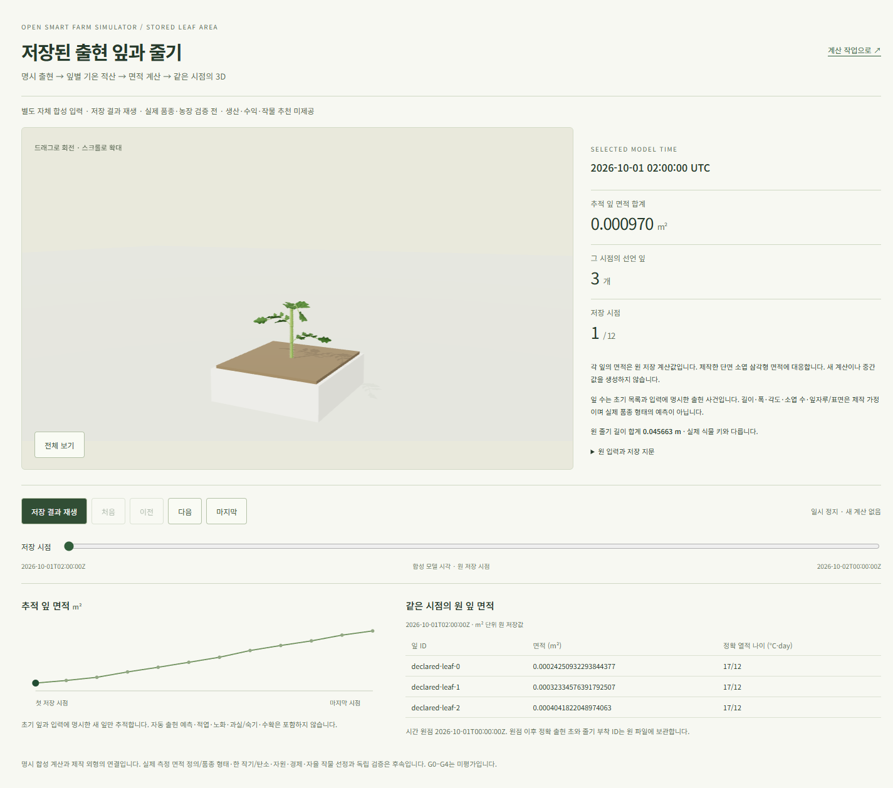
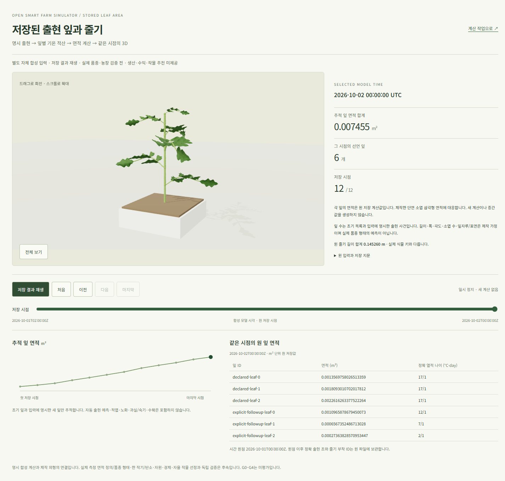
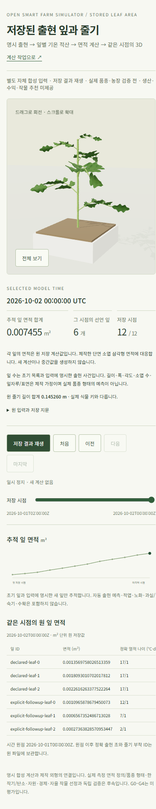

# 저장된 출현 잎과 같은 UTC의 3D — 2026-10-23

상태: [표시 계약](../contracts/web-leaf-population-replay-v1.md)의 **자체 합성 연구 UI 기능 수용**.
[새 잎 화면](http://localhost:5176/leaf-population-replay.html)에서 원 저장12시점의 명시3→6잎을 확인한다.
현재 농장 작업의 자동 계산 결과와 연결하는 단계는 남아 있다.

## 구현과 실제 확인

[무계산 frame reader](crop-leaf-population-frame-20261023.md)와
[양쪽 권리 export](crop-leaf-population-export-20261023.md)의17파일을 strict SDK로 읽는다.
root `9b156ea33c87af66681a05df3a6630ae85c8f346a57d3d81b2c3f5c4525fc077`,
index `78f1f6c828b5af0935ee09a60a92375659e3525e428781f88ed21b489e79f388`와
원 program/stem/frame bytes, binding·모델/코드·단위·정확 출현/나이·ID/개수를 대사한다.
기존 초기3잎 화면/geometry를 재사용하고 별도 entry로 새 출현 자료를 선택한다.

실제 Windows Chrome의 반복 검사에서 **고유12시점/52잎 면적**과 원 stem 길이·ID,
3D/요약/표/그래프의 UTC·정확 나이를 대사했다. 제작 단면 소엽 삼각형 면적의 원 m² 대비
최대 상대차는 **7.300708330464573e-15**, 계약1e-9 이내다.
첫/마지막 canvas 차이, 마지막에서 재생하면0부터 전진·정지,
유휴1.2초 frame 증가0, 390px overflow0과 heading/control/table 구조를 확인했다.
원 fixture17 GET·POST/API 요청0이며 이 반복 검사의 애플리케이션 오류/경고는0이다.
첫 ready595ms는 단일 환경 관측이며 성능 기준 수용이 아니다.

새 격리 프로필의 cold 검사에서는 위 기능 검사와 마지막6잎 모바일 캡처 뒤
**경고0 단정이 실패**했다. 애플리케이션 예외0/HTTP 비정상0이지만,
`THREE.WebGLProgram`의 `X4122` 상수 덧셈 정밀도 경고1이 있다.
첫 실패에서 진단을 저장하지 않은 결함을 고쳐 경고 원문을 보존했다.
전체 native cold 검사를 통과했다고 표시하지 않으며 원인 수정/해당 GPU 환경 재검증은 남긴다.

| 첫 시점 | 마지막6잎 | 마지막6잎 모바일 |
| --- | --- | --- |
|  |  |  |

위 이미지는 cold 검사의 실제 화면이다. 잎 수/출현은 명시 입력이고 자동 예측이 아니다.
형태·소엽 수·각도·표면은 제작 가정이며 실제 품종/관측 면적 정의 검증은 남는다.

## CI·배포·실행 보존

소스 `7d3d4d5b2c9742f4b79b81c61446ad55f64711c9`의
[집중 CI39870510699](https://github.com/KIMSUNGHOON/OpenSmartFarmSim/actions/runs/39870510699)는
타입·10파일/85단위·build·Chromium20과 audit high gate를 통과했다.
원3잎/줄기/외형/실행 회귀와 WebGL 불가 때 원 표 유지를 포함한다.
**audit moderate2는 남아 있다.** 전체 backend/web 및 별도 native CI는 실행하지 않았다.
초기 타입 오류와 재생0 확인 누락을 수정한 뒤 이 소스에서 통과했다.

종료된5176을 필요한 범위에서만 복구했다. 기존 물리 DB/키·원 입력·동결 backend772파일을
유지하고 새 비공개 auth/TLS를 발급했다. 기존25표 행 SHA는
`02711ef673b441d2f1d6d01f27421bb2f8e296703fe882d03725c8d3f5fdbe87`로 같고,
기존 완료 작업/결과/계산 시각·원12시점의 인증 HTTP 조회200·추가POST0을 확인했다.
첫 grant의24시간5분 설정이 서버의1일 상한에 걸린 실패를 보존하고 발급 전 검증으로 고쳤다.
현재 grant는2026-10-24 08:12 KST까지다. 토큰 값은 공개 기록에 넣지 않았다.

CI 산출물219파일 중 **새22파일만 추가**했다. 각 HTTP200/no-store·원 SHA와
기존205파일의 inode/소유·권한/size/mtime/ctime/SHA를 확인했다.
기존 HTML/초기3잎 진입은 같은 bytes다. 자산 배포 중 backend/DB/nginx 변경0이다.
현재5175 외형과5176만 실행 중이다. 이전5173/5174는 종료 상태이며 자료/키는 보존한다.

WSL 보호 root는 실제 생존한2개다. 각 phase의 .25초 계측·512MiB/합계1GiB·소유 정리를
[기계 판독 증거](artifacts/leaf-population-stored-replay-20261023.json)에 기록했다.
가장 큰 디자인 capture phase 합계1,034,874,880bytes로 상한 안이었다.
Windows Node/Chrome 메모리는 이 합계 밖이며 공통 용량 수용이 아니다.

## 디자인 비교의 범위

12ui로 기존 연구 화면을 기준 삼아 마지막6잎/전체 페이지와 비교했다.
첫 monorepo `src` 경로 오류와 durable 경로 변경 거부를 보존했다.
기존 변환 LayerDoc을 재사용해 `web/src` 기준의 추가 구매 없는 새 비교를 마쳤다.
capture/convert/plan은 settled, DOM coverage66.7%/design78.1%로 매칭 gate가 통과했다.
이는 최종 디자인의 픽셀 일치나 사용자 R2 승인이 아니다.

kit의 plant/graph raster 교체는 실제 WebGL·원 저장값 SVG·회전/재생 요구와 충돌하므로 적용하지 않았다.
고정3잎/수치·표 삭제와 전체 높이 압축도 새6잎 내용 보존 조건에 맞지 않는다.
기존 CSS/자체 호스팅 Noto Sans KR/컨트롤을 유지했고 두 실제 화면을 직접 비교했다.
변환에서 제안한 색/글꼴 미세 차이는 원 CSS의 변경 근거로 채택하지 않았다.
최종 사실감 R2·품종 형태와 디자인 정렬 수용은 미완료다.

## 다음 단계·외부 의존성·일정

다음 한 단계는 새 leaf 입력의 출처/모든 원 단위·현재 검토를 원 stem 입력 증거와 결속하는 것이다.
정상 원 bytes/metadata, 재배포 금지 보존, rehash 뒤 변조·현재/늦은 철회 거부와
발급/검증의 생장 import·계산/DB/CLI/쓰기0을 수용 기준으로 삼는다.
그 뒤 등록 농장/현재 원 stem 완료 결과 → 서명/자동 worker → 같은 job의 API/제품3D 순서다.
개발에는 합성 입력을 쓰고 실제 품종/독립 자료 확보를 병행한다.

첫 입력 증거 자식의 설계/구현1–2시간·집중 반례/fresh1–2시간·검토/기록0.5–1시간,
합계 **2.5–5집중시간**은 기존 stem 경계를 재사용한다는 가정의 낮은 신뢰 작업량이다.
후속 DB/서명/worker/API/UI와 실제 자료 확보 시간을 포함하지 않는다.
실제 Axiany 계수/초기 관측·독립 농장 작기0이므로 전체 완료 날짜는 미정이다.
한 작기/탄소·생산/자원·경제·자율 작물 선정과 G0–G4는 이 화면으로 수용하지 않는다.
정확 native `gpt-6.1-sol / xhigh`와 재귀 CLI0을 위 기계 증거에 기록했다.

**후속 수용:** [leaf 입력 증거52/fresh](crop-leaf-population-input-evidence-20261023.md)를 수용했다.
위 첫 자식 추정은 그 실제 수용으로 대체하며 다음은 현재 농장/완료 stem 결과 결속이다.
새 증거 모듈은 아직 사용자 runtime에 배포하지 않았다.
