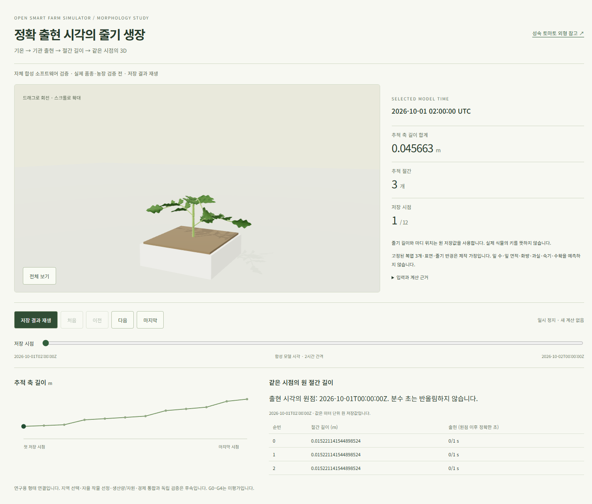
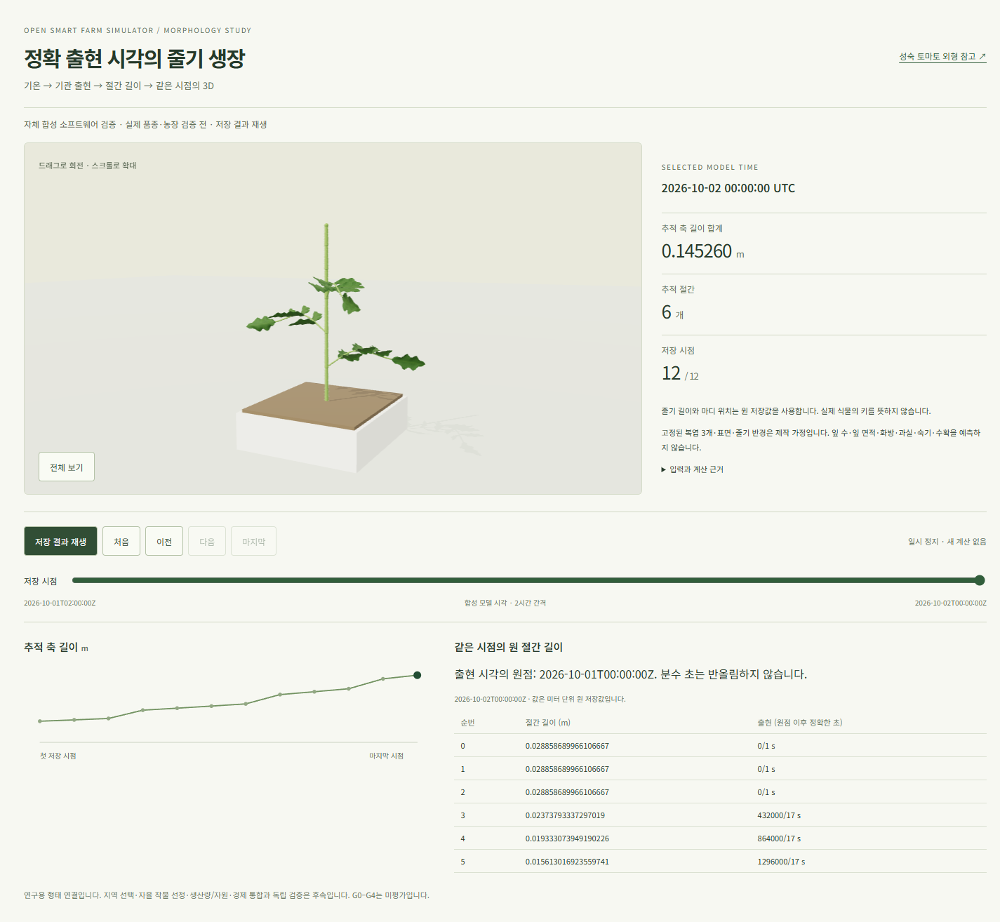

# 정확 출현 시각의 저장 형태 3D 수용 — 2026-10-22 KST

[별도 판본 화면](http://localhost:5173/morphology-lab/morphology-rational-replay.html)을 적용했다.
[계약](../contracts/web-morphology-rational-stored-replay-v2.md)의 v2 원점/분수 초·원 길이를
실제 WebGL/표·그래프/재생에 연결한다. 기존 v1 진입/원12프레임은 유지했다.
같은 authored 복엽/재질·장면을 재사용하며 새 계수/과실·키/생산 예측을 추가하지 않았다.
[기계 증거](artifacts/morphology-rational-stored-replay-20261022.json)에 실제 CLI 문맥과 원 지문을 기록했다.

기존 v1 소스에서 새 소비자16검사는2실패/14통과였다. v2 후보는16검사를 통과했다.
원12프레임/지문·원점/축약 분수·단위/미지원/가짜 UTC/기관 ID·순서/권리 범위·순차13 GET와 변조 보류를 확인했다.
local Node heap160MiB/semi-space4MiB를 사용한4표본은 PID192,946,176/합1,051,389,952bytes였다.
처음 baseline의 합1,067,569,152bytes도 보존했다. 둘 모두1GiB 안이며 로컬 빌드/브라우저로 확대하지 않았다.

CI [39647444957](https://github.com/KIMSUNGHOON/OpenSmartFarmSim/actions/runs/39647444957),
source954054877b820687b40932dfba106359482cd167에서 typecheck·집중 unit38(기존22+새16),
build/audit0·Chromium11(기존7+새4)이 통과했다. 전체 web/backend 회귀 수용은 아니다.
새 v2의 첫/끝·원점/정확 출현 초·원 길이/실제 mesh ID·재생·mobile/변조·WebGL 보류를 포함한다.
v1 console 진단은0, v2는 기존에 정의한 정확 driver ReadPixels stall4건의 원 text/location/timing을 보관했다.
두 경우 앱 warning/error와 앱 readPixels 호출은0이다. 일반 graphics 성능 hold를 해제하지 않는다.

source와 CI 배포물을 대사하고175파일의 실제 HTTP bytes/SHA·no-store를 확인했다.
같은 NGINX master의 lab alias만 새 bundle로 바꾸고 v1 index를 유지했다.
기존190/223/137파일·이전 lab bundle/원6root를 보존했다. backend/DB/키·토큰/모델은 바꾸지 않았다.
다운로드45표본/합869,244,928bytes·wall11.350406초, 배포3표본/합811,503,616bytes·wall0.526745초였다.

Windows 전용 Chrome 탭에서 원13본문·원 UTC/원점/분수 초/길이/기관 ID/축 합계와 표·그래프·실제 geometry를 대사했다.
첫3기관/0.045663424634695575m에서 마지막6기관/0.14526009414404015m로 바뀌었다.
키보드·재생/정지·전체 자동 재생의 마지막 정지·font 정착 뒤1.5초 idle·390px 문서 overflow0도 확인했다.
요청은 검증한 static 파일의 GET뿐이며 데이터 GET13/동시1·POST/API0·console warning/error0이다.
첫 관측 렌더456ms는 이 세션의 관측이며 cold start/SLA가 아니다. 창은 마지막/정지 상태로 남겼다.
native19.087454초/.25초74표본에서 WSL PID124,559,360/합875,307,008bytes·6root 생존이었다.
Windows Chrome/Node 메모리는 이 합계 밖이며 공통 용량 수용이 아니다.

이 결과는 자체 합성 하루의 저장 재생이다. 고정3복엽·표면/반경은 제작 가정이며 실제 품종/기관·독립 측정은0이다.
관문은 not_assessed다. 농장 custody/현재 권리·실제 작기/생산·자원/경제와 최종 제품 UI 통합은 후속이다.
