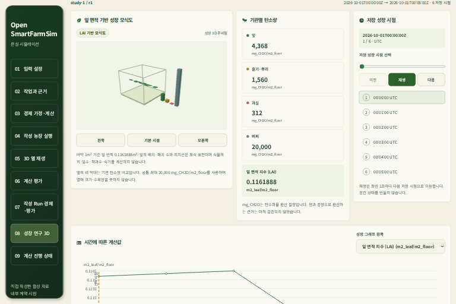
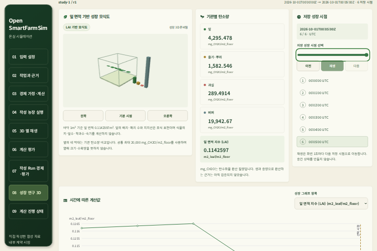
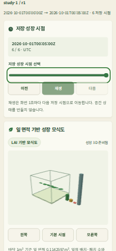

# 기관 v1 목록 선택과 기존 저장 생장 3D — 2026-10-20

## 수용 범위

기존 `organ_v1` 목록의 닫힌 SDK와 picker 선택을 기존 `LegacyCropReplay`로 연결한
**소프트웨어 자식**이다. 현재 Codex CLI `gpt-6.1-sol` / `xhigh` 세션에서 구현·판단했으며
CLI를 재귀 실행하지 않았다. [서버/보호 API의 별도 수용](organ-catalog-server-api-20261020.md)을
선행으로 사용했다. 이 브라우저 검사는 실제 API/DB를 사용하지 않았다.

source `8386a89a1b94ad0f2bed090b425303c65969a6d5`에서 원 `crop-result-v1:` ID/farm4를 그대로 전달한다.
목록 조회는 기존 30초/64KiB, 호출당 GET1회·취소/늦은 응답 거부를 유지한다.
기관 선택은 원 기관 조회를 한 번 수행하며 계산 작기·수확 부모로 변환하지 않는다.
선택/kind/계정 변경과 현재 조회 거부는 이전 수치·표·3D를 제거한다.
기존 스타일·계수·수치 계산은 바꾸지 않았다. 임의 생장 애니메이션을 추가하지 않았다.

## 원 응답과 시험 fixture

기존 native TLS/SCRAM/Bearer의 metadata/오류 7본문은 원 길이/SHA256과 일치한다.
정상 목록/작물 선택 원 bytes도 편집하지 않았다. 캡처는 선행 backend source의 증거다.
`replay_value`는 실제 HTTPS 응답을 파싱해 보존한 **소프트웨어 fixture**이며 원 wire bytes가 아니다.
작성 농장 envelope와 브라우저의 권리 거부 전달은 합성 시험이다.
`Fetch.fulfillRequest`가 이 fixture를 전달했고 자체 정적 서버의 실제 `/v1/` 경로는 403으로 막았다.
실제 농장 Run 0·G0–G4 미평가와 기관 family/U1 미완료를 유지한다.

## 검증과 실패 이력

- SDK 신규20·picker 신규2를 RED→GREEN으로 확인했다. 관련3파일 **136개**를 통과했다.
- 타입 검사는 unused test variable 수정 뒤 실제 종료0/4.202753초로 통과했다.
- 첫 [전체 CI39430443395](https://github.com/KIMSUNGHOON/OpenSmartFarmSim/actions/runs/39430443395)는
  단위1,886개와 타입/빌드/audit를 통과했으나 브라우저210통과/1실패/45미실행이었다.
  원6시점/WebGL 검사는 통과했다. 성공 뒤 접힌 lookup details 안의 버튼을 바로 누르려는
  시험 절차가 실패 원인이었다. 네이티브 summary를 먼저 펼치도록 시험 한 줄을 수정했다.
  제품 코드와 30초 제한은 유지했다.
- 수정 뒤 [전체 CI39432287995](https://github.com/KIMSUNGHOON/OpenSmartFarmSim/actions/runs/39432287995)는
  **36파일/단위1,886개·Chromium256개·타입·프로덕션 빌드·보안 high 기준**을 통과했다.
  신규 브라우저6조건은 원6시점/실제 WebGL, 현재 거부, kind 변경, 늦은 kind/계정 응답,
  390px 키보드/마지막 저장 시점이다. 전체 backend CI/native Solar job은 실행하지 않았다.
- 같은 CI의 minified build ZIP을 GitHub artifact digest와 대사하고 source/정적 자산을 고정했다.
  다운로드 guard는 실제 종료0/14.294527초였다.

WSL native Chromium은 같은 minified 빌드를 사용했다. 실제 종료0/11.490555초,
단일/합산 최대 RSS **389,836,800/1,018,347,520bytes**,
0.25초 간격 44표본이다. 512MiB/PID·합1GiB·600초를 유지했다.
원6시점과 모바일 마지막 시점의 총7관측에서 원 ID/5표시 UTC·4탄소값/LAI를
readout·표·실제 WebGL canvas와 대사했다. 잎 도형 면적도 LAI와 대사했다.
390/320px 가로 넘침 없음과 현재 거부 시 수치·표·장면 제거를 확인했다.
합성 credential만 사용했고 실제 API/DB·현재 사용자 서비스는 수정/재시작하지 않았다.

native 최초 시도는 slider의 wrapping label을 aria-label 속성으로 오인한 시험 선택자로 실패했다.
후속 시도와 진단은 320px 축소 직후 그래프의 직전336px child를 측정해 document363px를 기록했다.
실제 새 parent는266px였고 기존 ResizeObserver/rAF가 아직 반영되기 전이었다.
최종 actor는 실제 slider를 선택하고 그래프 child가 새 parent 폭과 같아지는 조건을 기다렸다.
같은320px 기준을 통과했으며 CSS·제품/CI source·viewport·상한은 변경하지 않았다.
앞선 실패/진단의 종료와 보존/정리는 기계 증거에 따로 남겼다.

보호5root·원본2,148항목·두 frozen source/자산·FD4→4를 보존했다.
소유 nginx/Chrome/프로세스·PG/임시/passfile 잔여0이며 제품 source/자산과 상태 feed가 같다.
[기계 증거](artifacts/organ-catalog-web-20261020.json)에 실제 guard·해시·fixture 출처·한계를 기록했다.
아래 캡처는 DPR0.5의 소프트웨어 fixture이며 실제 농장 성장/생산 예측 증거가 아니다.

## 남은 의존성과 일정

원 승인3상태 target/HTML을 보존했다. 기존12ui0.2.65의 동일 kit/key 재개를 이번에 한 번 더
시도했으나 외부 서비스의 `Too many conversions are already in progress`로 종료1이었다.
새 구매가 정착됐다는 기록은 없고 원 conversion/plan·디자인 대조는 미수용이다.
이 기능 자식은 CSS나 PNG 복제를 추가하지 않았고 디자인 수용을 대신하지 않는다.

다음은 현재 minified App을 **실제 원 저장 row의 API/DB**에 연결해 원 ID/UTC·값,
현재 권리/제거·복구와 source/자원/정리를 확인하는 단계다.
기존30초 안의 실제20건/큰 packet 목록, 최신 backend의 보존 CODE 지원,
구획v2/startupv3 검색 선택·원3디자인·API/PG/브라우저 동시 재시작 RSS와 사용자 적용이 남는다.
현재 기관 family/U1과 새 목록 UI 배포를 완료 처리하지 않는다.

이번 CI 대기 시점에 제시한1–3집중시간은 추가 실패가 없을 때의 **소프트웨어 자식 검증/정리**
작업량이었다. 실제 API/DB 통합·사용자 적용과 전체 goal 일정은 포함하지 않았다.
전체 제품 완료일은 U2–U5·전체 작기 생산/자원/경제·실제 CLI 종단 간 G1과
자료 권리/독립 농장·G0–G4의 남은 작업과 외부 자료 확보 상태를 근거로 다시 산정해야 한다.
현재는 전체 완료 날짜를 확정할 근거가 없다. goal active를 유지한다.

## 사용자 진행 기록 게시

두 주소의 개발 진행 JSON에 이번 소프트웨어 자식의 완료 범위와 실제 API/DB 연결·전체 goal 일정 미정을 게시했다.
최초 게시 준비는 기존240자 길이 검사를 넘겨 게시 전에 거부됐고, 문구를 줄여 기존 검사를 통과했다.
최종 guard는 실제 종료0/0.346420초·합575,688,704bytes였다. 실제5173/5174의200·원 bytes 일치·
`Cache-Control: no-store`, 두 frozen HTML과 환기 source2,173파일·5root/원본/정리를 확인했다.
새 UI 코드를 활성화하거나 두 주소의 DOM을 다시 검사한 것은 아니다.
