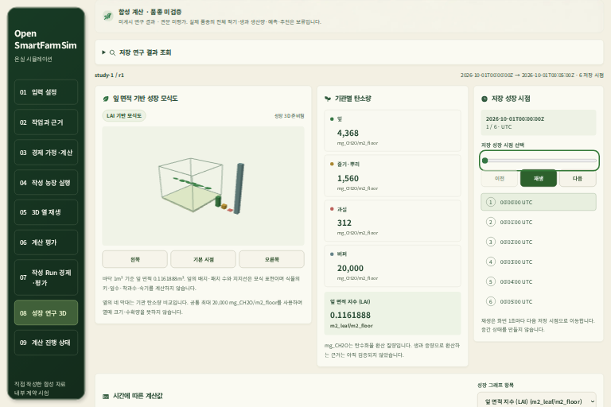
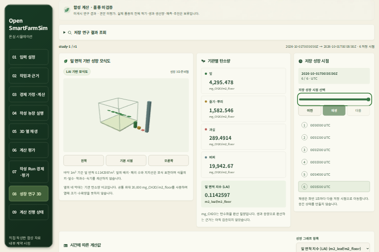
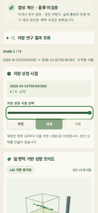

# 기관 목록의 실제 API/DB/저장3D 통합 수용 — 2026-10-21 KST

[계약](../contracts/crop-organ-native-acceptance-v1.md) ·
[기계 증거](artifacts/organ-native-integration-20261021.json).

## 수용 범위

**기관 v1 목록 선택→실제 저장소/HTTPS→원 저장값의 WebGL·표 연결을 hosted 소프트웨어 자식으로 수용했다.**
새 정상 synthetic producer가 만든 정상/숫자 보류2결과다. 응답 mock을 사용하지 않았다.
실제 농장·역사적 원 row의 현재 reader 호환성, WSL5root 동시 용량/사용자 적용·전체 U1과 G0–G4는 미수용이다.
현재 native Codex CLI `gpt-6.1-sol` / `xhigh`에서 판단했으며 재귀 CLI/하위 agent 호출은0이다.

source `92c64563b978d88b25de7f3cbea0a29cfcd80fa0`의
[CI39444301162](https://github.com/KIMSUNGHOON/OpenSmartFarmSim/actions/runs/39444301162)가 성공했다.
전체 웹36파일/단위1,886개·Chromium256개·타입/프로덕션 빌드/audit와 별도 native 작업을 통과했다.
같은 실행의 minified artifact를 digest/commit으로 확인했다. 전체 backend CI와 Solar 실행 검사는 하지 않았다.
제품 계산·UI 코드는 수정하지 않았고, 앞선2회의 native 실패와 관측기 보완은 아래에 별도로 남겼다.

## 실제 경로와 관측

SCRAM PostgreSQL16.15·기존 ApiRuntime/Bearer·검증된 upstream HTTPS를 사용했다.
정적 frontend는 원 status/body를 전달했다. 농장 목록→등록 작물→`organ_v1`의 원 결과를
선택하고 키보드로 원6시점을 이동했다. 원 ID/UTC·4탄소값/LAI, readout·표·WebGL과 잎 면적을 대사했다.
모바일 마지막 시점, 새로고침/재연결, 권리 복원과 계정 복원까지 총10개 실제 장면 관측이다.
1536×1024/390×844·320px, DPR0.5와 ResizeObserver 반영 뒤 문서 넘침 없음도 확인했다.
권리 거부422·계정 거부403에서는 수치/장면을 제거했고, 복원 뒤 같은 원 결과를 다시 읽었다.
숫자 보류 결과는 실제 API의 hold 이유와 장면/표 없음으로 확인했다.

실제 **GET19응답: 200×17,422×1,403×1**이었다.
서버/브라우저의 모든 path/status가 일치했다. 성공17본문의 bytes/SHA256을 대사했고,
SDK가 실제 끝까지 읽은17본문의 경로/수·no-store·30초를 확인했다.
SDK가 소비하지 않는 오류2본문은 브라우저 헤더와 장면 제거로 검증했다.
해당 오류 본문의 bytes/hash는 검증된 upstream proxy의 관측이며 SDK 소비로 주장하지 않는다.
최대 upstream 전체6.227745초·브라우저 성공 본문6.234860초·SDK 소비6.233700초였다.
기존30초·목록64KiB·재생2MiB를 유지했다. 일반20건/큰 packet의 용량 증거는 아니다.

정상/보류 원 row·payload/hash/서명이 보존됐다. 선택한 DB 개수는 전후
`crop_research_results=2`, `jobs=89`, `job_events=89`, `thermal_g1_runs=0`으로 같았다.
조회 중 put/integrate/RHS/SQL 쓰기는 각각0, proxy 오류와 page 오류도0이었다.
synthetic program-rights predicate와 시험 계정의 실제 runtime 거부/복원을 확인한 것이며,
실제 자료 이용권이나 독립 농장 검증을 승인한 것은 아니다.

## 종료·자원과 WSL 보존

hosted native는 **실제 종료0/57.591821초**, 관측 최대 단일368,406,528/합707,407,872bytes,
225표본/.25초·FD6→6이었다. 원512MiB/PID·합1GiB·600초를 유지했다.
HTTPS 서버 종료와 소유 프로세스/PG/임시·자격증명 정리, source 보존을 확인했다.
호스팅 수치를 WSL의 기존5root를 포함한 동시 실행 수용으로 바꾸어 쓰지 않는다.

완료 artifact ZIP을 GitHub digest와 대사했고 source4파일/모든 추출 파일 해시를 확인했다.
WSL 다운로드 guard는 실제 종료0/3.737115초·단일113,844,224/합644,763,648bytes였다.
기존5root·원본2,148개·두 frozen source/자산·FD4→4·소유 프로세스/PG/임시/자격증명 잔여0을 확인했다.

아래 실제 캡처는 DPR0.5의 **synthetic6분 연구 계산의 수치 모식도**다.
품종 외형·줄기 높이/실제 농장 생육·미래 생산량의 시각 검증이 아니다.

## 실패 이력과 남은 작업

[첫 native 실패](organ-native-integration-progress-20261020.md)는 최종 응답/종료 대기120초였고
정확한 브라우저 blocking 동작은 미관측이었다. [두 번째 진단](organ-native-observer-recovery-20261021.md)은
10화면 관측 뒤 미완료 본문 관측2개를 확인했다. 세 번째 source는 헤더와 SDK의 실제 본문 소비를 구분했다.
첫 실행의 미관측 지점을 사후에 특정 원인으로 단정하지 않는다.
모든 실패의 종료/자원/정리를 보존했고, 최종 수용은 이번19응답·원 row·종료 대사 뒤 판단했다.

다음 U1의 작은 검증은 원30초 한도에서의 실제20결과/큰 packet 목록 용량이다.
역사적 row/지원 reader·다른 저장 판본·원3상태 디자인·WSL 동시 재시작/권리와 사용자 적용도 남는다.
원 디자인 외부 변환 hold를 이 hosted 기능 수용으로 해제하지 않는다.
CO₂/기공·물/양분·구매 에너지·경제 연결과 U2–U5·실제 CLI 종단 간 G1,
권리 있는 실제 자료/독립 농장·시장·G0–G4의 나머지 조건도 유지한다.
새 목록 UI/Solar는 미배포이며 실제 농장0·전체 완료일 미정·goal active다.

두 로컬 주소의 개발 진행 JSON에 hosted 자식 수용과 다음20결과/큰 packet·미배포/전체 미완료 범위를 게시했다.
실제5173/5174의200·같은 bytes/no-store, 원 두 HTML/환기2,173파일·5root/원본 보존을 확인했다.
게시 guard는 종료0/0.339896초·합578,101,248bytes·FD4→4/소유 잔여0이었다. 새 UI 활성화/DOM 재검사는 하지 않았다.
