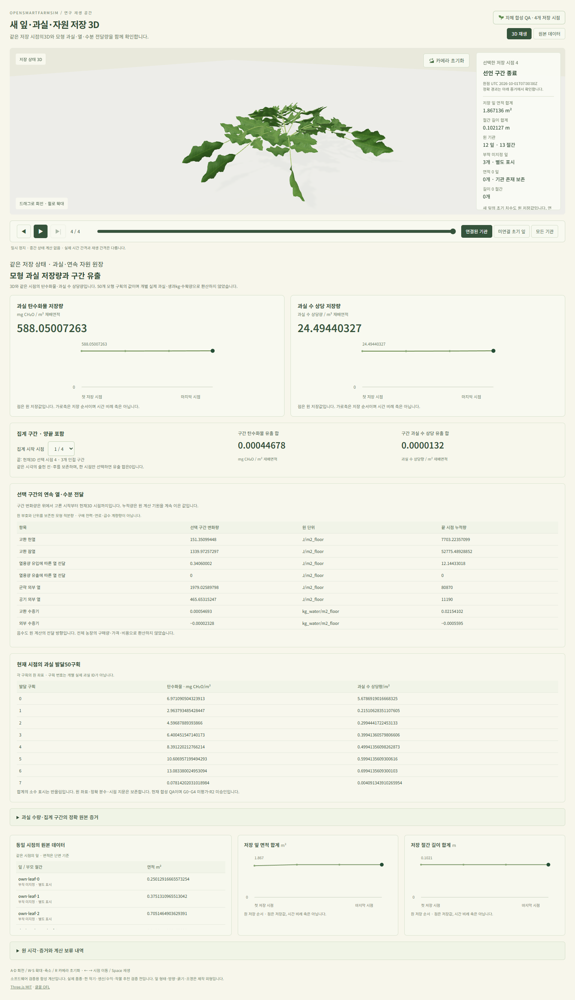
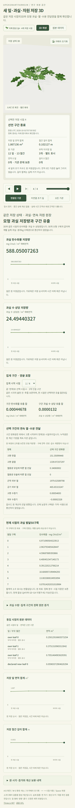
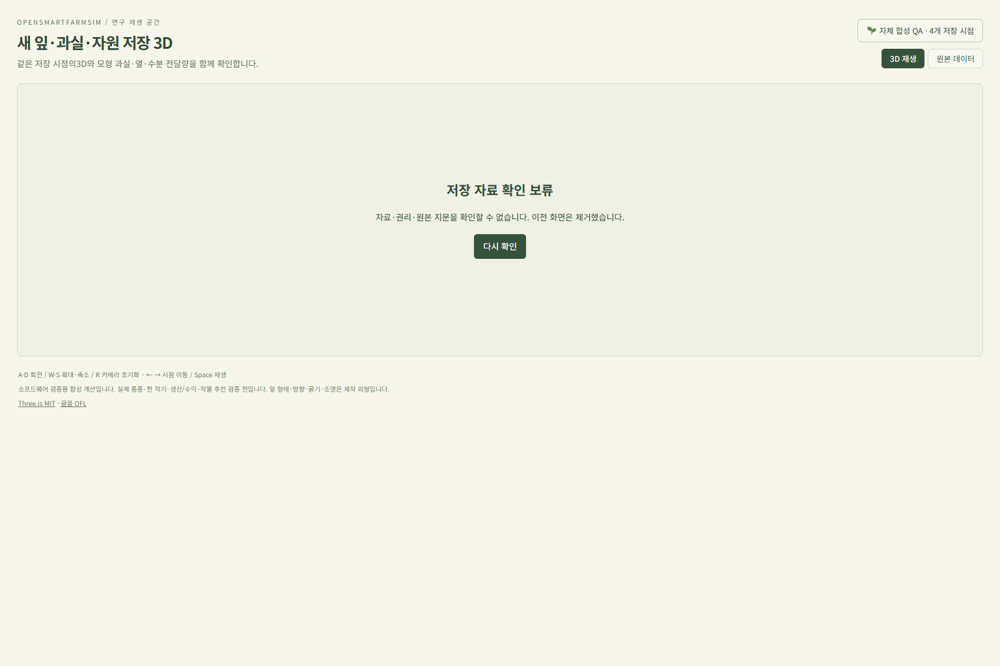

# 같은 저장3D의 과실·연속 자원 화면 — 2026-10-31

[확인용 화면](http://localhost:5184/supply-material-quantities-replay.html)을 **오늘17:03 KST까지** 제공한다.
기존3D와 같은4개 저장 상태에서 과실 탄수화물·과실 수 상당량,50개 발달 구획과
선택 구간의 열·수분8항목을 확인한다. 새 계산이나 실제 농장 관측은 없다.
[계약](../contracts/supply-material-quantity-http-screen-v1.md),
[기계 증거](artifacts/supply-material-quantity-screen-20261031.json).

## 구현과 원 자료

[독립 SDK](../web/src/supplyMaterialQuantityReplay.ts)는 수용된 model106파일을 한 번 검증하고
[공개 수치 fixture](fixtures/supply-material-quantity-own-20261031.json)와 동일59,468bytes를 읽는다.
성공 한 번은107GET/14,044,698bytes이며 코드/원 source·cursor/frame/state SHA·권리/NOTICE·
재배면적·정확 시각/phase를 보존한다. Python float 원 lexical 형식을 유지해 canonical result를 대사한다.
정수 필드에 `0.0` 같은 float 형식은 허용하지 않는다.

50구획의 각 binary64 값·정확 합계,10개 lifetime counter와 양끝 포함 선택 구간을 BigInt 분수로 대사한다.
0시간 채택 전후·한 시점 합0·인접 차/망원합과 음수 자원 전달을 보존한다.
표시는8자리 반올림이며 매우 작은 음수도 부호를 잃지 않는다. 원 값과 정확 분수는 별도로 확인할 수 있다.

[화면](../web/src/SupplyMaterialQuantitiesPage.tsx)은 기존 실제 `SupplyMaterialScene`을 그대로 사용한다.
11→12잎/12→13절간의 원 치수·부모와 같은 저장 시각에 수량·자원 패널이 연결된다.
새 잎의 원 초기 면적은 양수이며0으로 만들지 않았다. 3D의 잎 형태·자세·굵기·조명은 제작 외형이다.
수량 result SHA별 선택 보존, first 제한, 이전 응답/취소와 재검증 실패 때 모든 이전 표시 제거를 구현했다.

## 통과한 검증과 수정 기록

- 최종 집중 **56검사**: SDK7/wire33/표시8/선택8. 원4state·400과실 좌표·10counter/
  구간과 변조·권리·단위·정수 lexical/float·중복/UTF-8/깊이/비유한 값·한도,
  HTTP404/503/redirect/취소/latest·독립 복사를 확인했다.
- 전체 앱 타입과 새 Vite 설정 타입, 독립 SDK 번들152,540bytes와 최종 화면 빌드를 통과했다.
  고정 빌드는238파일/21,012,689bytes이며 이전 빌드/공개 자료는 변경하지 않았다.
- 별도 실제 HTTP324요청에서 두 정상107파일 조회·누락107과 초과/redirect/대기 중 취소를 확인했다.
  첫 정상 HTTP+decode는4.796648초였다. 원4형태/수량과10합계가 일치했고 인증/cookie 전송0이었다.
- 격리된 실제 Windows Chrome156.0.8078.74에서 최종 고정 주소/CSP를 포함해15대사 호출,
 13회 mesh 확인을 수행했다. 원4시점/47잎·51절간/400좌표·8자원 행·10counter·정확 참조/
  시각/phase·그래프, 메뉴/reload/시작 구간·0시간 경계·끝 재생/유휴·3보기,
  잘못된 수량 파일의3D/수량/그래프 제거와 같은 선택 복구를 확인했다.
- 390px 페이지 가로 넘침0, WebGL 부재 때 검증된 표와 명시3D 보류를 확인했다.
  정상/모바일/보류 검사에서 console error·warning/외부 요청·GET 외 요청0이었다.
- 초기 missing-module RED, wire test 인자 포장 오류와 실제 정수 lexical 누락2개를 구분해 기록했다.
  누락은 wrapper byte 수와 window index의 원 lexical 검사로 고쳤다. JSX 괄호와 test tuple/
  소유 ArrayBuffer 타입 오류도 통과 전에 수정했다. 첫 정상 화면에서 기존 표 높이가 일부 자원 행을
  숨겨8행 모두 보이도록 바꾼 뒤 최종 빌드/브라우저를 다시 통과했다.
- 첫 fixed-browser controller는 Python UNC 문자열 escape 구문 오류로 브라우저 시작 전에 실패했다.
  경로를 안전한 literal로 생성한 새 controller가 통과했으며 실패 증거도 보존한다.

## 디자인·자원·보존

12ui0.2.65로 기존 승인 C/root와 a/stock·b/table의 변경 없는 LayerDoc을 대상으로
root/stock/resource/cohort 최종 캡처4개를 close했다. 구매0·target-only/unanchored·coverage0이며
추출 assets/반복 token 변경도0이다. 원 C/a/b와 실제 데스크톱/390px를 함께 검토했다.
이는 pixel 일치나 R2 승인이 아니다. 기존 승인 shell·글꼴/색/간격·표·SVG 아이콘을 재사용한다.

kit의 사진/센서 그림·38시점/예시 날짜/두께·유출 그래프는 원 자료가 아니므로 사용하지 않았다.
사용자의 실제3D·계산 상태 연결 요구에 따라 실제 mesh·원4점 SVG/동작 controls를 유지했다.
배경은 기존 승인 CSS를 유지하며 미추출 raster/추가 장식 아이콘을 추정해 만들지 않았다.
각 raster 선언과 적용 예외는 private review에 기록했다.

WSL 한 번에 한 phase, PID512MiB/합계1GiB/600초 guard를 사용했다.
최종56검사는28.207초/PID368,062,464bytes/합계741,117,952bytes,
전체 타입7.615초/428,199,936/564,830,208,
최종 빌드2.163초/401,526,784/538,386,432였다.
최종 고정 주소 브라우저의 WSL controller는25.539초/35,954,688/180,568,064였다.
**Windows Chrome와 전체 host RSS는 측정하지 않았으므로 WSL 수치로 대신 주장하지 않는다.**
각 phase 소유 자손 잔여0·FD4→4와 기존 GUI/원4500감시 항목을 보존했다.

수치 부모666source/1output/private120, 이전 화면657source/4output/private307과
원101CAS의 bytes/mtime/ctime/mode, 이전237고정 HTTP/기존 자료·GUI 계보를 대사했다.
새238파일은 실제 HTTP의 bytes/hash/no-store/CSP와 소유 PID/boot/start·첫 만료를 확인했다.
기존5181/5182/5183의 첫 만료를 연장하지 않았다.
현재 native6.1-sol/xhigh/CLI0.157.1의 실제 turn/output 지문을 보존했고 재귀 CLI 실행은0이다.

## 다음 단계와 남은 외부 의존성

다음은 [경제 계약](../docs/ECONOMICS.md)의 열/구매량 경계를 현재8counter와 대조하는 작은 설계 단계다.
산출물은 항목별 물리 의미·구매 가능 여부·필요한 설비/계량/단가 자료·hold 사유와
기존 Decimal 원장에 연결할 수 있는 입력 계약이다. 연속 heat/vapor를 전력·연료·관개로 간주하지 않는다.
개발은 명시 사용자 가정의 조건부 구매량/단가로 진행할 수 있지만, 이를 모델이 계산한 구매량이나
실제 청구액으로 표시하지 않는다. 고정 계수/요금이 없는 행은 hold로 남긴다.
근거 대조/작은 계약1–2집중시간 초안이며 실제 범위 확인 뒤 비용 구현 공수를 갱신한다.

긴 작기/반복 출현·실제 품종 매개변수, 생과 질량·수확/판매와 실제 자원 구매/설비·청구서,
독립 국내 농장 raw0, 경제/거시·수급·자율 작물 비교와 최종 제품 통합/R2는 남는다.
자료 확보는 개발과 병행하며 예측·추천 게시에는 원 G0–G4와 독립 증거가 필요하다.
G0–G4 `not_assessed`, R2 `not_approved`, 전체 goal active/incomplete·전체 완료일 미정을 유지한다.
전체 suite와 hosted CI는 이번 집중 검증으로 대체하지 않는다.
