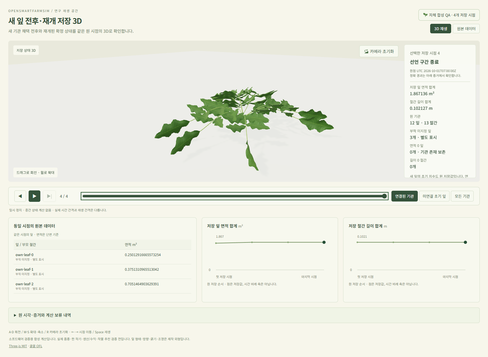

# 새 잎 전후·재개 저장3D — 2026-10-31

[새 화면](http://localhost:5183/supply-material-replay.html)을 **오늘16:00 KST까지** 제공한다.
[SDK](supply-material-http-sdk-20261031.md)의 원4시점/722상태값과 같은 잎·절간 mesh/표·그래프를 연결했다.
11→12잎·12→13절간이며 채택 전후는 같은 정확 분수 시각의 별개 상태다.
브라우저에서 생장/RHS·중간 frame을 만들지 않는다. 자체 공개 합성 연구 창이며 실제 품종 한 작기나
수확·생산량/에너지 구매·수익·자동 추천의 완료를 뜻하지 않는다. [화면 계약](../contracts/supply-material-stored-screen-v1.md).

기존 실제 mesh/잎 질감·조명·표/그래프/제어를 재사용했다. 원 phase를 유지하는 새 version을 만들었으며
이전의512초 CP로 바꾸거나 이전 수용 모듈을 수정하지 않았다. 새 초기 면적도 실제 저장값 그대로이며
0치수와 부착 미지정 기관을 보존한다. 잎 형태·방향/굵기·직선 축과 표시 위치/조명은 제작 가정이다.

## 통과한 검증

- 신규17검사:4frame의 독립 triangle 단면 면적47행·절간 세계 좌표 길이/부모51행,
  원 시각/phase/ID·실제 초기 면적·별도 renderer-only0면적·해제/입력 불변,
  root별 선택 저장/URL과 잘못된 선택·이전 dataset 선택 분리를 확인했다.
- 전체 앱 타입·새 Vite 설정 타입·별도 빌드가 통과했다. 공개106원 파일을 포함한237파일을 고정했다.
  UI JS 약2.096MB/전송 gzip 약425KB이며 Three.js와 기존 자기 호스팅 질감/조명/글꼴을 포함한다.
- 실제 격리 Chrome156: 임시 HTTP와 게시된5183에서 각각 같은4시점의 mesh 면적/길이/부모/0,
  compact/상세 표의 탄수화물·정확 나이/부족분·global 장부와 그래프 선택을 모두 대사했다.
  실제 삼각형133730→150362→150418→150418이며4시점의 원 기관을 표시한다.
  메뉴/reload·3보기 유지, 키보드/마우스 회전·초기화·유휴/재생 끝 정지,
  source 실패 때 이전 canvas/표/그래프 제거/같은 선택 복구,390px 모바일 가로 넘침0,
  WebGL 없는 경우의 원 표도 통과했다. 두 실행 모두 오류·경고/외부 요청/비GET0이었다.
- 새 고정 미리보기의 실제237GET hash/bytes와 소유 boot/PID/start·첫 만료를 대사했다.
  기존643source/1output·SDK private18개·원 CAS/source/export/GUI 사슬과4,500원 항목을 보존했다.
  기존5175/5181/5182와 각 만료를 연장하지 않았다.

최종 geometry17검사 약2.339초, 전체 타입 약7.856초/최고 RSS421,093,376bytes,
build guard 약1.800초/합계 최고495,783,936bytes, 실제 게시 browser guard 약29.705초였다.
WSL PID512MiB/합계1GiB와 소유 자식0/FD4→4를 지켰다. Windows/전체 host RSS는 미계측이며
격리 Chrome을 정상 종료했다. 현재 의도적으로 제공 중인 읽기 전용 미리보기는 별도 소유 프로세스다.
기존 SDK93검사는 불변 부모 증거이며 이번17검사에 재실행한 것으로 합산하지 않는다.
전체 제품 suite/build·DB/worker/API/새 모델 계산·hosted CI는 이번 수용에 포함하지 않는다.

## 디자인과 초기 실패

12ui0.2.65의 이전 승인 C/shell과 원 변경 없는 LayerDoc을 재사용했다. 실제 새 캡처에 target-based
improve를 실행했고 capture/convert/plan은 settled, 새 구매0/추출 자산0/recurring token delta0이었다.
image-only **unanchored** kit이므로 DOM coverage0이며 픽셀 일치/R2의 수용 증거가 아니다.
원 C와 이전 화면·새 첫/끝/모바일 캡처를 직접 검토했다. 개념 사진/정적 그래프·예시 날짜/기관/38시점은
사용자의 실제3D·원 계산 표시 요구와 달라 채택하지 않았고 실제 mesh와 원4점 SVG/기존 아이콘·CSS를 유지했다.

첫 RED는 미구현 import였고, 초기면적0이라는 잘못된 시험 가정을 원 저장값과 대조해 고쳤다.
새 설정 검사기의 private 경로에서 `vite/client`를 찾지 못한 문제는 설정 전용 타입 범위를 고쳐 해결했다.
첫 improve의 image+repo 조합은 CLI가 거부해 image-only로 다시 실행했다.
첫 게시 browser 검사기는 이름 교체로 `own-public-v2`를 요청해 조기 실패했다.
그 검사기의 정확한 Windows Node root/생성 시각과 자손만 대조해 잔여 격리 Chrome5개를 종료했고
소유 잔여0·무관 프로세스 종료0을 확인했다. 원 자료를 바꾸지 않고 v3 검사기를 수정·통과했다.
초기 보존 검사는 하위 사슬과 결과 파일명이 겹쳐 최종 쓰기가 거부됐다. 새 보존 폴더의 v2로
전체 사슬/237GET를 다시 통과했다. 초기 시도와 출력·정리 증거는 모두 보존했다.

정확 native `gpt-6.1-sol/xhigh`·실제 CLI 세션과 산출물/판단/시험 지문은
[기계 증거](artifacts/supply-material-stored-screen-20261031.json)에 있다. 재귀 CLI/새 subagent0이다.
독립 국내 raw0·첫 실제 품종 미확정, G0–G4 `not_assessed`/R2 `not_approved`·전체 goal 미완료를 유지한다.

## 다음 한 단계

**같은4시점의 모형 과실 저장량·구간 유출·저장 자원 적분량 조회**를 먼저 연결한다.
새 source/cursor/phase를 보존하는 읽기 전용 투영과 독립 Fraction 검증, 같은 시각의0시간 물질 경계,
구간 망원합·원 단위/재배면적·음수/타입/권리/변조·무계산/보존이 다음 수용 기준이다.
기존50구획 산술을 참고하되 이전 CP 참조를 만들어 넣지 않는다. vapor·heat 적분량을 관개/전력 구매나
실제 수확/판매량으로 바꾸지 않는다. 첫 수치 조회1–2집중시간, 공개 SDK/같은3D 패널1.5–3집중시간의
잠정 추정이며 검증 뒤 갱신한다. 다음은 명시 자료/단위에 근거한 Decimal 비용·시나리오 연결이다.
긴 작기/반복 출현·실제 품종/독립 농장/경제·거시/수급·자율 비교/최종 제품 수용은 남아 있으며
전체 완료일·외부 자료 확보일은 아직 추정할 근거가 부족하다.
